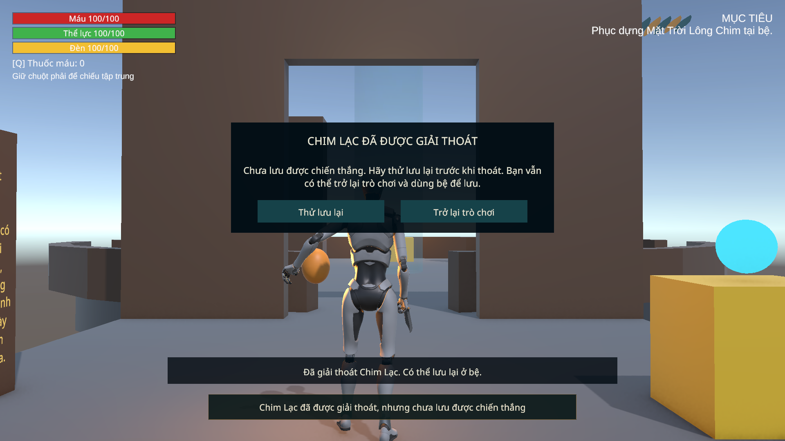
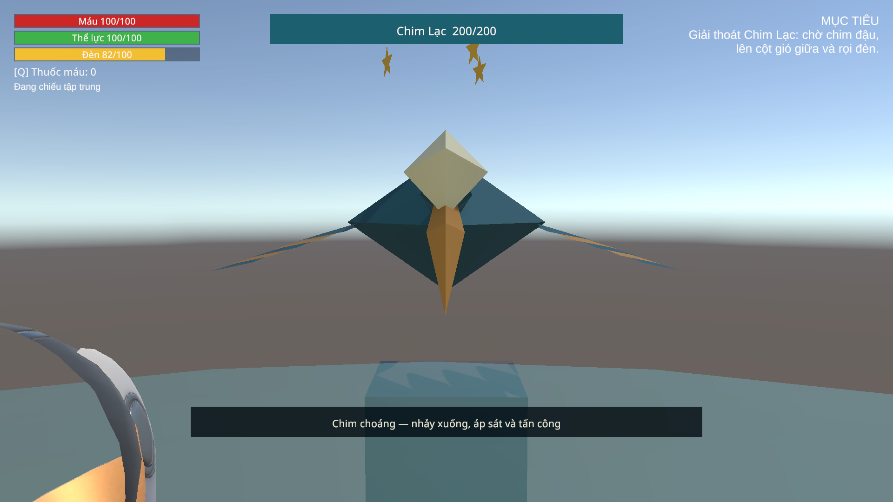

# C2 lượt5 — Đấu trường Chim Lạc

Bắt đầu05/11, kiểm chứng/bàn giao06/11/2026, Asia/Bangkok. Theo [hàng đợi](CHAPTER02_MECHANICS_PLAN.md), phạm vi là cơ chế P5, HUD/báo đòn và lưu chiến thắng. Không triển khai C3, phục dựng/Linh Thần kết C2 ở lượt6 hoặc toàn bộ art/audio lượt7. Giữ An, ID và schema4. Backup trước sửa: `SourceAssets/SceneBackups/2026-11-05_C2Arena/234952`, manifest `Logs/C2Arena-backup.json`.

## Runtime và cảnh

- `BossChimLac`: giữ200HP, đậu3.5s/2.5s khi≤100HP, Focus1.5s từ hover, choáng4s/x1.5/trần60damage, quạt báo.8s+đẩy2s, lao báo1s+.4s, đứng đất1.5s, bay đổi cột1s. Pha hai lấy lại độ cao giữa hai cú lao; mỗi cú có cảnh báo và hướng chốt riêng. Thời gian đậu đọc pha hiện tại; chim quay về An khi đậu/quạt.
- Cú lao có dấu điểm đáp trên nền, sweep Environment để dừng trước vật cản, kiểm LOS khi gây damage, kết thúc ở nền18m. Tránh LookRotation với vector0; mỗi cú hit tối đa một lần. Reset/disable/defeat xóa dấu báo thế giới, cờ quạt và Focus. Timer/đổi pha chờ qua Pause đúng ranh giới thời gian.
- `BossBase`: từ chối damage khi chưa kích hoạt hoặc đã chết; thắng gọi lưu và phân biệt thất bại bằng `DefeatSavePending`. `TrySaveDefeat` thử ghi lại cùng checkpoint, không thêm thưởng/ID mới. Giữ thắng trong phiên nếu đĩa chưa lưu được, mở lối và báo rõ; không ghi nhận giả rằng file đã lưu. Continue luôn theo snapshot thật trên đĩa.
- `ArenaGate`: cổng C2 yêu cầu `c2_door_arena`, không bắt đầu khi pause, actor chết hoặc boss component không hoạt động. Field mới tùy chọn; C1 không cấu hình thêm. Chết tải lại scene/mốc trước trận như API GameSession hiện hành.
- `ChimLacFocusReceiver`: cặp collider nhận tia và CharacterController bỏ va chạm vật lý; vẫn raycast được. Không đổi collision matrix toàn dự án. Điều này ngăn An đứng trên quả cầu nhận tia thay vì tiếp đất khi áp sát. Cặp ignore được duy trì khi collider controller được bật lại.

Scene03 có `VIS_ChimLac_Combat` dưới boss root: mesh chim đơn giản do dự án tạo, dùng khối tám mặt, lông đã có, màu xanh lam/rêu và đồng, cổ dài/mỏ/cánh/đuôi rõ. `ChimLacPresentation` chỉ điều khiển các phần model theo FSM; không sở hữu root motion hoặc damage. Sao/cúi cổ khi choáng, không nhuộm màu thân. Đây là **combat proxy**, chưa phải model/rig Chim Lạc cuối cùng. Không tải asset mới hoặc dùng asset trả phí.

`ChimLacArenaHUD` hiển thị hướng dẫn theo trạng thái, nhãn pha nổi giận, tiến độ Focus và bảng thử lưu lại khi thắng mà lưu thất bại. Bảng dùng IUiPauseOwner hiện có, có nút thử lại/trở về trò chơi; không thêm input map hay EventSystem. Thanh máu cũ được căn giữa phía trên, tách HUD nhân vật và mục tiêu. `ART_C2_Arena/Dive_Landing_Marker` không collider. Giữ DisallowGPUDrivenRendering cục bộ của lượt4 cho các mesh mới; không đổi pipeline C1 hoặc NavMesh.

## Kiểm chứng và giới hạn

Công cụ opt-in: `Chapter02ArenaSetup` nhận `Library/SonDoongC2Arena.request.json` với apply/validate/test/input-test; từ chối Play hoặc scene chưa lưu. `Chapter02ArenaProbe` bảo vệ primary/bak/tmp, cô lập AI P4, dùng fixture C1 completion/C2 prerequisites/vị trí đầu bài. Các đòn riêng được gọi qua chính coroutine production sau dừng vòng AI để đo; bài pha hai dùng vòng AI thật.

Bài input dùng Input System/InputReader/CharacterController thật, giữ guard focus. Helper `SourceAssets/Tools/C2ArenaFocusGameView.ps1` chọn cửa sổ Unity hiện tại và tab Game bằng Ctrl+2. Không đặt tiến độ Focus hoặc gọi damage API để thay cho kết quả RMB/LMB của bài này. Save/Continue/Respawn dùng GameSession/SaveService thật; save chiến thắng bằng damage fixture được ghi riêng với bài chiến đấu input.

Console Error Pause tạm tắt trong harness rồi trả lại, mọi error vẫn được thu để làm phép thử thất bại. Các lần phát triển thất bại giữ ở Logs; không coi là đạt. Bản Windows mới, cân bằng người chơi thật, FPS và art cuối chưa nằm trong lượt này.

## Kết quả06/11

[Editor](reports/C2_Arena_Editor_2026-11-06.json): **8checks,0failures**. [Play Mode cuối](reports/C2_Arena_PlayMode_2026-11-06.json): **87checks,0failures,0runtime errors**; chạy lại toàn bộ sau chỉnh nền/đặt hướng dẫn HUD. [Input riêng](reports/C2_Arena_Input_2026-11-06.json):19checks đạt trước chỉnh tương phản HUD. Không cộng các lượt thử để gọi là một lượt87.

- Chưa vào trận không damage được; trigger không bỏ qua cửa hoặc bắt đầu khi Pause. Không có Lông Gió Lớn thì cột tắt; có công cụ thì trigger thật nâng An lên24.5m. Chiếu từ đất không bỏ qua luật hover.
- Focus đủ1.5s, grace.25s, Pause/delta lỗi, choáng4s, x1.5 và trần60damage được đo qua component thật. Chim rơi đúng nền18m, sao/cúi cổ, bay bất tử; Reset xóa HP/FSM/focus/cap/cảnh báo.
- Quạt có.8s cảnh báo, đẩy mặt đất khoảng8m trong2s, Pause đứng yên; cột gió che chắn đúng. Cú lao báo trước/điểm chốt cố định, né khỏi điểm đó không bị homing; một cú trúng20một lần, vật cản dừng cú lao và chặn damage. Pha≤100HP có hai cảnh báo/hai cú lao từ trên cao, hai hit tổng40, reset/disable không để dấu báo treo.
- Lưu trước trận, chết thật qua Vitals.Kill fixture và GameSession.Respawn thật: boss200HP/Waiting, cổng mở, focus/HUD sạch, An về nền checkpoint. Thắng bằng damage fixture khi SaveService chưa ready: giữ thắng trong phiên, mở lối và bảng retry, native save cũ chưa có thắng. Nút Retry ghi được native schema4, Continue giữ boss ẩn/cổng mở, Reset không hồi sinh trùm đã lưu thắng.
- Bài input: W/Shift qua trigger thật khóa cổng; W vào cột gió/lên hover; **RMB qua scanner** gây choáng; **Space** rời hover; W/Shift xuống áp sát rồi **LMB qua CombatController** giảm HP trùm. Aiming được đặt bằng camera fixture; không phải kiểm mouse-look tay. Reset giữa kiểm entry và kiểm aim được nêu riêng; không gọi đây là một trận200HP chơi tay trọn vẹn.

Lần input đầu cho thấy vùng nhận tia hình cầu có thể chặn An tiếp đất; collision matrix hiện có cho Player6 va với LanternTarget10. Sau ignore riêng cặp collider, input xác nhận chân18.02m, controller grounded và hit chém thành công. Giữ log phát triển ở `Logs/C2Arena-input-attempt1.json`. Không nới cửa sổ choáng hoặc sức nhảy để che lỗi này.

Save cá nhân primary/bak/tmp trả **byte-for-byte**, Console Error Pause trả giá trị gốc; [bàn giao SHA/meta](reports/C2_Arena_Delivery_2026-11-06.json), [Editor cuối](reports/C2_Arena_EditorState_2026-11-06.json). Hai scene C1, PlayerMotor và NavMesh C2 không đổi. Shared ArenaGate/BossBase có hợp đồng mới nêu trên; không chạy lại full C1. Báo cáo C2 lượt0 về damage sau Reset là lịch sử; hiện boss Waiting chủ động từ chối damage.

Phần cơ chế lượt5 đã kiểm chứng; **kế tiếp lượt6: phục dựng, ba câu Linh Thần, lưu kết C2 và nhánh C3 chưa sẵn sàng**. Chơi tay để cân nhịp, model/rig Chim Lạc cuối, full camera/art/audio/FPS/Windows C1→C2 còn ở nghiệm thu lượt7. Không tự dựng C3.
