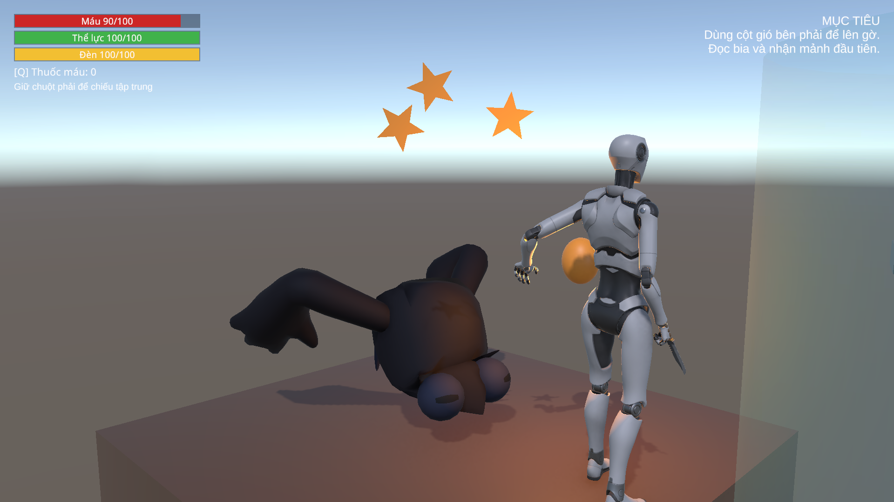
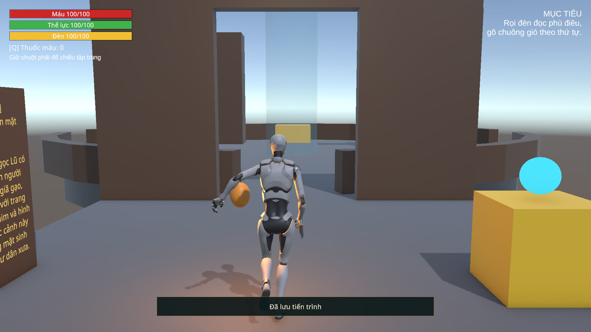

# C2 lượt4 — Cầu Mây Gãy và Hắc Ảnh Ném

Ngày05/11/2026. Phạm vi là lượt4 trong [hàng đợi C2](CHAPTER02_MECHANICS_PLAN.md), không triển khai đấu trường/trùm ở lượt5 hoặc C3. Scene03 vẫn là greybox; art/âm thanh toàn chương chờ lượt7. Giữ model/rig An, ID và schema4.

## Thay đổi

- Hai Hắc Ảnh tuần tra và hai Hắc Ảnh Ném trong Scene03 dùng Ghost A08 đã nhập, vật liệu/controller/clip Stunned đã có của dự án. Không sửa FBX nguồn hoặc ghi lại asset C1. Thrower dùng `ThrowerPresentation` riêng; AI sở hữu ném/đánh, animator không có root motion. Cả bốn receiver bật choáng4s, immunity3s, phải thả chiếu rồi chiếu lại; cúi đầu và có sao, không nhuộm màu thân.
- Thrower trở lại cấu hình spec C2: nhận biết14m, báo.6s, hồi2.5s, đạn7m/s/12damage; cận chiến2m/10damage/hồi1.6s. Cấu hình10m/3s trước lượt này là thử nghiệm cũ. LOS tính từ tay ném, mất LOS hủy báo đòn. Trong tầm gần mà melee đang hồi thì không xen ném. Giữ một bộ điều khiển/actor, thrower đứng tại gờ và không thêm NavMeshAgent.
- `EnemyProjectile` kiểm overlap ban đầu trước SphereCast; Environment ưu tiên nếu chồng với player, đánh dấu consumed trước damage. Chặn launch không hữu hạn/zero, giữ hướng đã chốt, pause không tiến thời gian. `EnemyLanternReceiver` chặn delta NaN/Infinity.
- `RequirementDoor` ghi tạm Doors trong batch chưa phát event, SaveAt thành công mới công bố mở; thất bại trả snapshot và giữ cửa đóng, có chặn gọi lồng. Giữ nguyên collider Environment của cánh cửa: scanner lấy IInteractable ở cha nên vẫn tương tác được. Không thêm collider chặn vô hình khi cửa mở.
- `World_Geometry/ART_C2_Bridge` có hai khối nấp ở(3.9,18,44.5)/(6.1,18,60.5), chừa tim đường. Bake NavMesh C2 vào asset cũ, giữ GUID. Hai khe1.5m và cột gió/gờ giữ nguyên; không nới jump/motor để làm bài thử đạt.
- Khi chuyển C2→menu trong Play Mode, gặp lỗi GPU Resident Drawer `BatchDrawCommand` với Batch/Mesh/Material ID không còn hợp lệ. Riêng các root có MeshRenderer trong Scene03 được gắn component Unity `DisallowGPUDrivenRendering`, áp cho con, để dùng đường vẽ thường. Không tắt GPU Resident Drawer toàn dự án hoặc đổi pipeline C1/Editor. Đây là xử lý tương thích cục bộ; chưa đo ảnh hưởng FPS và cần đánh giá lại ở lượt7.

Component loại trừ theo [hướng dẫn URP chính thức của Unity](https://docs.unity.cn/6000.7/Documentation/Manual/urp/make-object-compatible-gpu-rendering.html); API thực tế được đối chiếu source `com.unity.render-pipelines.core/Runtime/GPUDriven/Components/DisallowGPUDrivenRendering.cs` đang cài. [Issue Tracker Unity](https://issuetracker.unity.com/issues/16859/error-error-a-batchdrawcommand-was-submitted-with-an-invalid-batch-when-returning-from-prefab-view) ghi nhận cùng thông báo lỗi trong bối cảnh khác; không coi đó là bằng chứng xác định chính xác nguyên nhân của ca chuyển scene này.

Backup trước sửa: `SourceAssets/SceneBackups/2026-11-05_C2Bridge`, manifest `Logs/C2Bridge-backup.json`. Công cụ có chủ đích `Chapter02BridgeSetup`: request `Library/SonDoongC2Bridge.request.json`, action apply/inspect/validate/test. Refuse Play hoặc scene chưa lưu; không chạy ChapterBuilder dựng lại toàn cảnh để đọc cấu hình. `Chapter02BridgeProbe` chỉ chạy opt-in trong Editor và bảo vệ save primary/bak/tmp.

## Phạm vi kiểm tra

API/physics dùng vị trí và C1 completion làm fixture, dừng các AI khác để đo từng quái. Input E/RMB/W/Space đi qua Input System/InputReader thật và giữ guard focus. Helper Windows `SourceAssets/Tools/C2BridgeFocusGameView.ps1` chọn đúng cửa sổ Unity Doan_Game3D hiện tại, không dùng PID cũ; chỉ đưa Game View ra trước trong bài input. API receiver dùng riêng để kiểm thời gian choáng/recovery; không gọi API đó để nhận là đã thử RMB.

Ca lỗi lưu đĩa khóa riêng file tạm trong ô lưu đã bảo vệ. Một diagnostic I/O dự kiến được ghi riêng, không tính là lỗi runtime ngoài dự kiến. Phải giữ save chính nguyên vẹn và cửa đóng, sau thả khóa phải mở/lưu lại được. Đây không thay thế thử đĩa đầy/mất điện.

Console đang bật Error Pause nên diagnostic dự kiến từng làm Editor tạm dừng sau cùng một frame. Harness hiện tạm tắt đúng cờ này, ghi giá trị gốc và trả lại ở Finish; vẫn thu toàn bộ log lỗi ngoài dự kiến để làm bài thử thất bại. Không thay guard focus/input/pause của game. Ca chết chạy trên quái đã bật Brain để listener Died hoạt động, thay cho fixture vô tình giết quái đang bị harness tắt AI.

Lần dựng đầu thiếu Animator vì FBX Ghost không tự có component này; helper đã thêm Animator như cách C1 dùng. Lần thử đầu dừng do harness chỉ tìm collider layer8 trong khi cửa dùng collider layer3 và IInteractable ở cha. Không kết luận đó là lỗi scanner; sửa harness đúng hợp đồng và bổ sung kiểm E qua scanner thật. Báo cáo các lần phát triển giữ trong Logs; save được trả sau từng lần.

Kết quả cuối ghi tại [Editor](reports/C2_Bridge_Editor_2026-11-05.json), [Play Mode](reports/C2_Bridge_PlayMode_2026-11-05.json), [Delivery](reports/C2_Bridge_Delivery_2026-11-05.json), [Editor state](reports/C2_Bridge_EditorState_2026-11-05.json). Không dùng kết quả này để gọi toàn bộ C2 hoàn tất, FPS/độ khó đã cân hoặc Windows đã dựng mới.

## Kết quả cuối

**25 kiểm tra Editor, 117 kiểm tra Play Mode đều đạt**,0failures/0unexpected runtime errors; có1diagnostic I/O dự kiến khi cố ý khóa file tạm. [Bài input riêng44checks](reports/C2_Bridge_Input_2026-11-05.json) cũng đạt; kết quả tích hợp117 đã chạy lại từ đầu sau khi sửa harness, không cộng các lượt thất bại để gọi là một lượt đạt.

- Đạn chạm tường mỏng/hai khối nấp không gây damage; trúng An đúng12một lần; overlap đầu trong player hoặc trong Environment được xử lý đúng; pause/expiry/NaN không làm hỏng cảnh.
- Hai thrower báo trước rồi ném7m/s theo hướng chốt, mất LOS hủy báo; melee10damage không lặp hoặc xen ném trong hồi; không đánh qua tầng. Choáng4s, sao/cúi đầu, giữ màu thân, miễn choáng lặp và nhả chiếu/recovery hoạt động. API dùng để cô lập nhịp AI; RMB qua scanner thật được kiểm riêng trong cùng lượt tích hợp.
- Thiếu từng mảnh/công cụ thì cửa không mở. SaveService chưa ready hoặc khóa file tạm thì rollback/giữ cửa, save chính nguyên vẹn. Thả khóa mở/lưu được, menu/Continue giữ cửa/công cụ/spawn an toàn. Giết quái hoạt động rồi chết/Respawn tải lại quái thường50HP, không giữ choáng và không làm mất cửa đã lưu.
- **E thật qua InputReader/InteractionScanner** chọn cửa từ collider Environment ở con và script ở cha. **RMB thật** gây suy yếu/choáng trên cả hai gờ, vách chắn ngăn Focus; không bypass guard focus.
- **W/Space thật** đi từ đầu P4 qua hai khe1.5m tới sân, bốn nhảy có tăng độ cao và đáp đúng: hai khe cầu, hai gờ y21 qua cột gió. Không teleport dọc tuyến cầu chính; khởi điểm cầu và đặt lại giữa cầu trước mỗi bài leo gờ là fixture. Đi qua trigger checkpoint thật ghi native save mới. Bật quái tại cuối bài vẫn không bị đánh ở spawn.

Save primary/bak/tmp và cờ Console Error Pause trả nguyên trạng. Hai scene C1, PlayerMotor và EnemyPresentation giữ SHA; shared RequirementDoor/EnemyProjectile/receiver có thay đổi nêu trên, chưa chạy lại toàn tuyến C1. Không dựng Windows mới. Kế tiếp **lượt5: Đấu trường Chim Lạc**, sau đó lượt6 kết chương, lượt7 art/audio/UI/nghiệm thu toàn tuyến.

