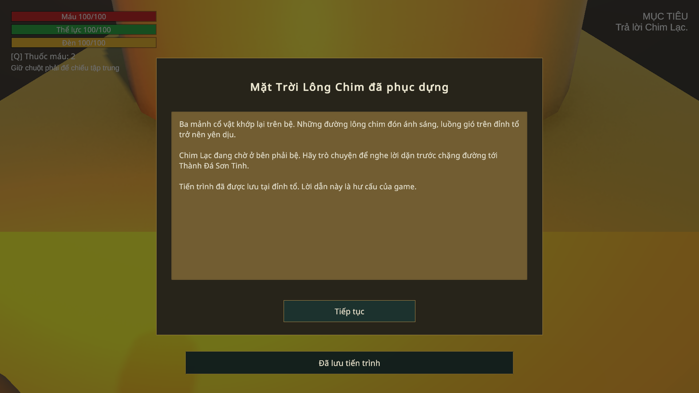
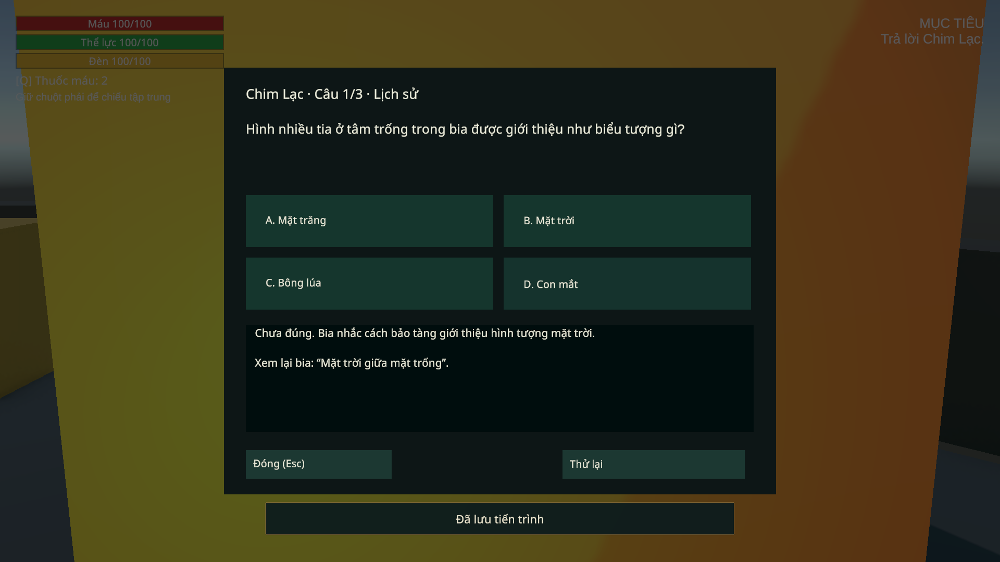
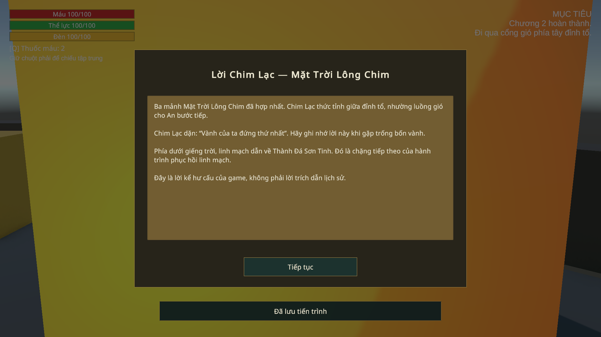
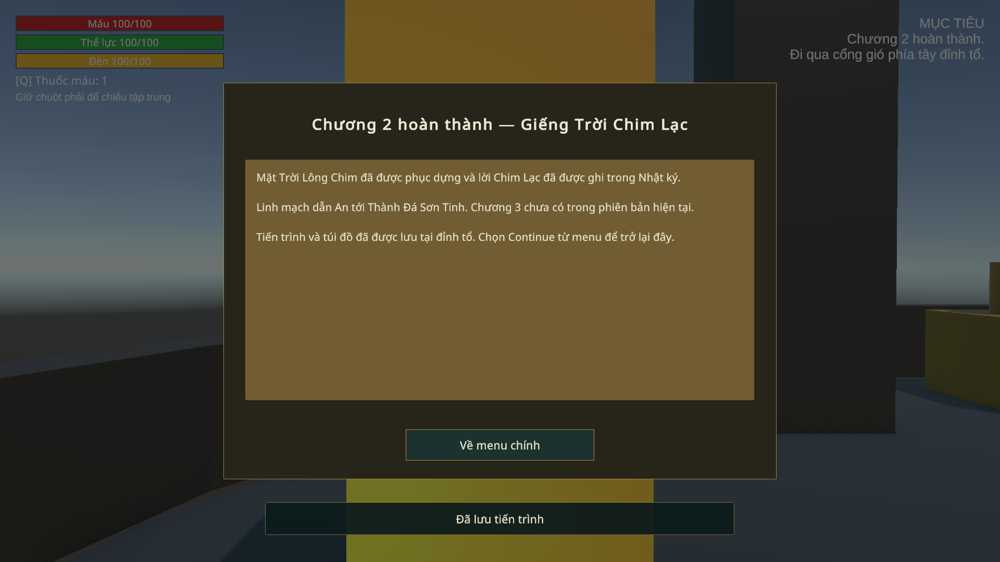

# C2 lượt6 — phục dựng, lời Chim Lạc và kết chương —06/11/2026

Thực hiện theo yêu cầu “tiếp theo”. Hoàn thiện phần kết trong scene `03_GiengTroiChimLac`, giữ ID/schema4, model An và tiến trình C1. C2 vẫn là bản khối; không dựng Chương3 hoặc coi đây là nghiệm thu toàn game.

## Thay đổi

- `RelicAltar`: đủ ba mảnh và hạ Chim Lạc mới phục dựng. Chuẩn bị trạng thái bằng batch, lưu thành công mới công bố/event/thẻ; thất bại trả snapshot và cho thử lại. Chặn tương tác lồng. C2 thêm `SC_C2_RelicRestored`, hướng người chơi sang Linh Thần; C1 vẫn trao Phúc Kim Quy và thẻ chuyển C2.
- `QuizSequence`: ba câu có nhãn tiến độ1/3–3/3; Esc hủy lượt, thử lại từ đầu. Đổi snapshot hủy callback cũ và đóng đúng câu do sequence sở hữu; thêm dữ kiện khác không hủy. Lưu cuối thất bại giữ điểm/câu đã trả lời trong phiên, chưa mở cổng; E thử lưu lại mà không hỏi lại cả ba câu. Cờ hoàn tất chỉ công bố sau khi ghi file thành công. Đọc lại lời Chim Lạc không hỏi lại/trao thưởng/event.
- `QuizPanel.Ask` thêm callback hủy và context tùy chọn, giữ callsite cũ. Cờ sai và điểm vẫn dùng Flags/QuizAnswered/QuizFirstTry, không tạo bộ đếm hoặc schema mới.
- `ChapterMemoryNotes` và `JournalPanel`: lời **“Vành của ta đứng thứ nhất”** xuất hiện trong thẻ và Nhật ký sau khi hoàn tất, vẫn đọc được sau Continue. Nội dung lời kể ghi rõ là hư cấu; không sửa nguồn tri thức đã xác minh ở lượt3.
- `ChapterExit_C2`: ghi lại túi đồ hiện tại tại `c2_cp_arena` trước màn kết. Nếu không lưu được thì giữ người chơi trong game để thử lại. C3 chưa có: thẻ nói rõ và nút **Về menu chính**; Continue trở lại đỉnh tổ. Không đăng ký giả `c3_cp_start` hoặc tạo scene C3.

## Kiểm chứng

[Editor7checks](reports/C2_Ending_Editor_2026-11-06.json): không missing scripts; đúng điều kiện, ba câu, thẻ/manh mối, ref lưu và nhánh C3 chưa có.

[Play Mode71checks](reports/C2_Ending_PlayMode_2026-11-06.json): **0failures,0unexpected runtime errors**,2diagnostic I/O dự kiến khi khóa file tạm. Đã thử:

- Từng mảnh/trùm còn thiếu; save chưa ready và file tạm bị khóa: không phục dựng, không event hoặc mất bản lưu chính.
- Phục dựng thành công lưu riêng; nhấn lại không lặp. E thật qua InputReader/scanner ở bệ, Linh Thần, thử lưu lại và cổng; có nền/capsule/LOS và chờ nhân vật tiếp đất.
- Sai/đáp án ngoài chỉ số/thử lại/Esc/gọi lặp; sai không lấy lại điểm lần đầu. Thay snapshot hủy lượt, world addition giữ lượt; lưu giữa chừng và Continue giữ điểm/cờ sai, không lưu index câu.
- Câu cuối đã đúng nhưng lưu lỗi chưa mở cổng/thẻ; thử lại khi file khóa vẫn an toàn; E sau đó lưu và hiện lời Chim Lạc. Callback kết đúng một lần khi đóng thẻ; đọc lại không tăng điểm/đồ.
- Nhật ký và manh mối sau scene/panel mới; cổng save lỗi không chuyển menu; kết chương ghi túi mới nhất, menu/Continue giữ cổ vật/điểm/cổng/trùm chết và vị trí an toàn.
- Hồi quy hẹp shared C1 altar: save lỗi rollback cả cổ vật/năng lực; thành công trao Phúc và nút cuối C1 vẫn chuyển/saved world sang C2.

**Giới hạn:** C1 hoàn tất/C2 ba mảnh, công cụ và trùm chết là fixture; AI/checkpoint trigger cô lập. Chọn đáp án và nút UI gọi production API/listener; E đi qua Input System thật. Không phải chơi tay toàn tuyến, kiểm restart process, cân nhịp/FPS hoặc Windows mới. Ảnh chỉ chứng minh UI trong Game View; model/bệ/cổng/địa hình C2 còn placeholder và thuộc lượt7.

Save primary/bak/tmp trả nguyên bytes; Console Error Pause trả giá trị ban đầu. Hai scene C1, PlayerMotor và NavMesh C2 giữ SHA; [delivery](reports/C2_Ending_Delivery_2026-11-06.json), [Editor cuối](reports/C2_Ending_EditorState_2026-11-06.json). Backup trước sửa: `SourceAssets/SceneBackups/2026-11-06_C2Ending/004128`, manifest `Logs/C2Ending-backup.json`.

Một lượt phát triển đầu của probe dừng vì đặt vị trí rồi tắt motor khiến An chưa tiếp đất; sửa harness chờ scanner production chọn mục tiêu rồi chạy lại. Không hạ guard tương tác. Helper focus có một lần đọc progress đang được ghi gây lỗi PowerShell không kết thúc bài; đã thêm đọc chịu lỗi. Không coi hai lỗi harness này là lỗi game đã sửa.

## Ảnh và tiếp nối

**Lượt tiếp theo khi người dùng yêu cầu:7 — đồ họa/âm thanh/UI C2 và nghiệm thu tuyến C1→C2.** Dùng asset miễn phí thực tế, giữ An; kiểm camera/va chạm, cân nhịp, Windows/Continue và ghi riêng phần cần người chơi thật. Chưa tự triển khai C3.
