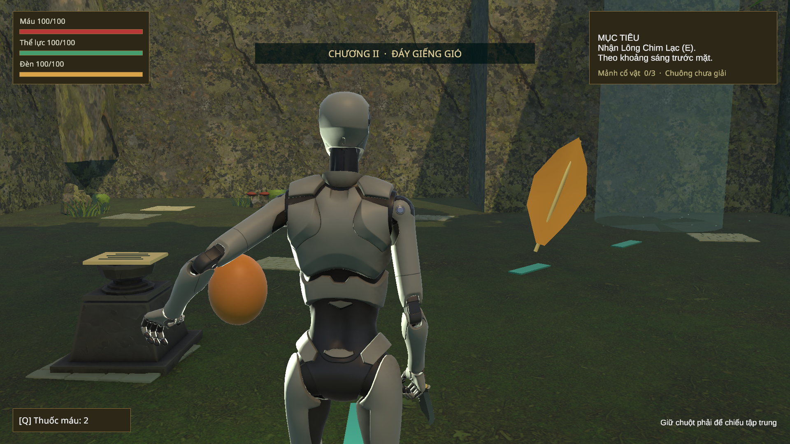
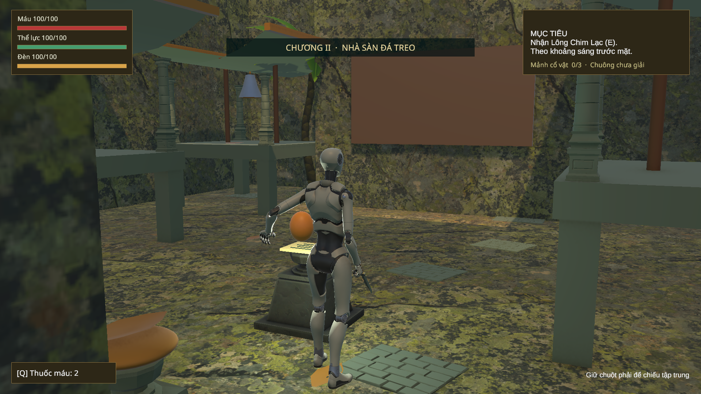
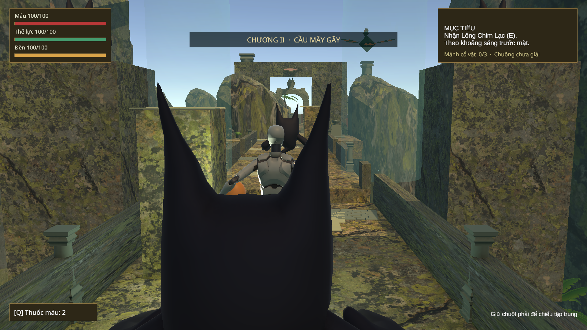
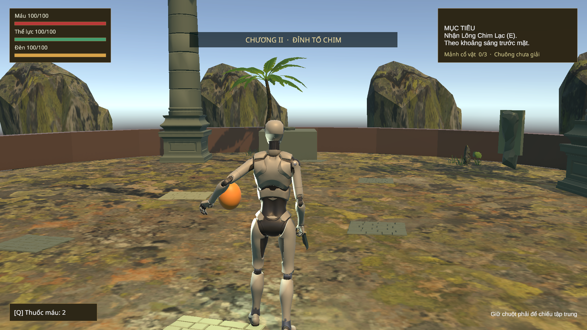
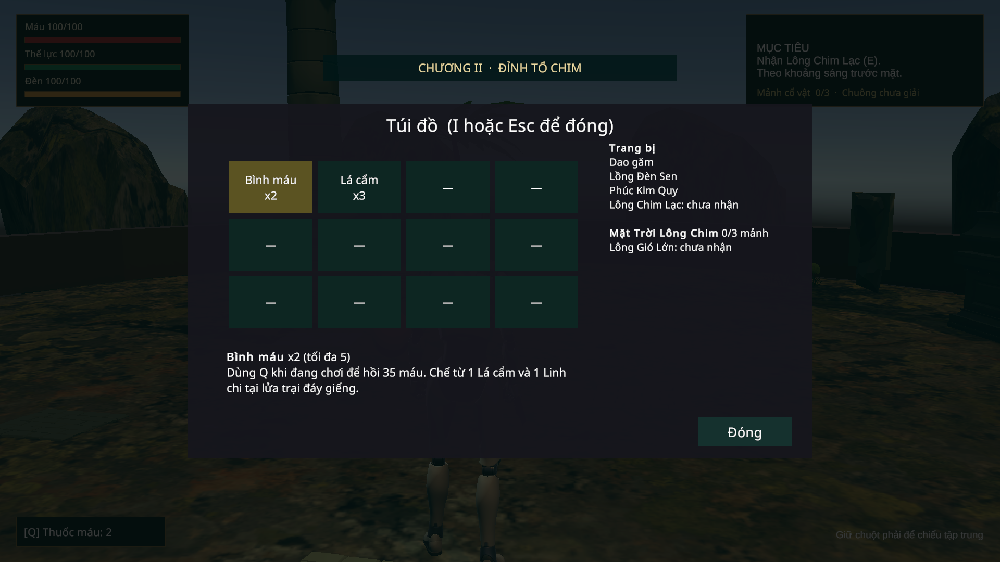

# C2 lượt7 — môi trường, âm thanh, HUD và bản Windows —06/11/2026

Thực hiện yêu cầu “Tiếp theo” sau lượt6. Scene `03_GiengTroiChimLac` được bổ sung đồ họa cho đủ năm khu; giữ model/rig An, luật leo/gió/chuông/chiến đấu, ID và save schema4. Chưa triển khai C3.

## Cảnh và asset

`World_Geometry/ART_C2_Environment` chứa các cụm đá, cây, lát đường và kiến trúc trang trí. Vách có mặt kín, UV theo kích thước thật để tránh kéo dẹt texture; đá A09 làm sườn/đỉnh giếng và vách xa. Không thêm collider trang trí vào tuyến đã kiểm tra, giữ nền/vách/lan can/hai khe cầu và NavMesh cũ.

P1 có cây dưới giếng trời và gờ cao nhìn thấy từ điểm vào; P2 tiếp nối các bệ/cột gió; P3 có ba mái cong, cột nhà sàn, chuông đồng và giá treo; P4 có trụ lan can, đá dựng ngoài cầu và cây dưới vực; P5 có cột đậu chạm khắc và bệ phục dựng. Cây/bụi/cỏ đặt theo cụm ở rìa, chân cây/đá bám cùng mặt nền. Các dấu đáp cũ được đổi hình sang lông chim.

Các bệ vấn đáp/checkpoint dùng A24; cổng dùng A22 tối ưu của C1. Vật nhặt được đổi hình lá/nấm/chai tương ứng, giữ object/script/pickup ID. Chim Lạc dùng hình cách điệu do dự án tạo với các pivot cánh/cổ theo FSM, thêm mào và bản Linh Thần thu cánh; không nhập rig chim bên ngoài hoặc thay An. Hình thái này vẫn cần phản hồi thẩm mỹ/người chơi, không gọi là bộ animation sinh vật hoàn chỉnh.

Ánh sáng giếng trời ấm, ambient lạnh xanh nhẹ, sương Exp2 mỏng `.0085`, cột gió trong hơn kèm hạt chuyển động. Giữ fallback `DisallowGPUDrivenRendering` chỉ C2, không đổi GraphicsSettings/pipeline C1. [Nguồn asset/âm thanh](CHAPTER02_ASSET_CREDITS.md).

## Âm thanh và UI

`C2SoundPalette` dùng lại group Music/SFX/UI của mixer hiện có. `SoundscapeRuntime` chọn palette theo scene và trở lại C1/menu đúng; crossfade khi quái ném/Chim Lạc giao chiến. Có tiếng gió 3D tại bảy cột, ba cao độ chuông, tiếng chim báo đòn; nhạc khám phá/đấu trường và các cue mới được tổng hợp trong `SourceAssets/Tools/c2_audio.py`, không phải bản thu nhạc cụ truyền thống. UI/SFX giữ cơ chế Master/Music/SFX và pause hiện hành.

`C2_HUD_Theme` tạo nền tối cho thanh tài nguyên/mục tiêu/ô thuốc; hướng dẫn đèn chuyển xuống phải dưới để không đè thanh đèn. Có tên năm khu khi đi qua và tiến độ mảnh riêng C2/chuông. Túi đồ trong C2 hiển thị **Mặt Trời Lông Chim**, năng lực gió, công cụ trùm và lời nhắc Nhật ký; không cộng ba mảnh C1 vào số mảnh C2. Mô tả thuốc C2 trỏ đúng lửa trại đáy giếng, giữ panel chế riêng của C2. Nhánh C1 giữ cách hiển thị/cơ chế cũ.

## Kiểm chứng và giới hạn

Kết quả cuối: **10Editor**, **77Art/UI/audio Play**, **140Traversal**, **123Bridge**, **87Arena**, **71Ending** đạt,0failures/0unexpected runtime errors theo từng report. Nhánh lỗi lưu có diagnostic I/O dự kiến như trong báo cáo. **Windows20checks** đạt; thêm một lượt20 bật native leak detection xác nhận đường thoát.

Lượt Windows đầu có22cảnh báo tự thu hồi GraphicsBuffer/ComputeBuffer,119persistent allocations và1TempJob khi quit. Chẩn đoán stack trace đi qua `GPUResidentDrawer/RenderersBatchersContext` của RP đang cài. `PlayerGraphicsShutdown` dùng public `IGPUResidentRenderPipeline`: disabled→reinitialize khi **Application.quitting trong player** để dispose trước khi native shutdown; không chạy trong Editor hoặc đổi chế độ lúc chơi, không sửa package/pipeline asset. Lượt cuối thường và lượt trace đều có `GPU Resident Drawer disposed`,0cảnh báo buffer/LeakDetected/JobTempAlloc/Exception. [Audit log](reports/C2_Art_WindowsLogAudit_2026-11-06.json).

Build cuối incremental:0errors/0warnings,370551689bytes; cold build trước đó485cảnh báo kernel compute `ConvGeneric`, không tuyên bố đã làm sạch mọi cảnh báo của một cold build. Native20 là tự động API fixture, không phải người chơi tự hoàn tất hai chương.

Đo trên RTX3060Laptop/i5-12500H,1920×1080/PC(Vừa),vSync0,120frame sau30frame làm ấm mỗi góc: P1 median3.84ms/P95 5.37ms; P3 median3.86ms/P95 5.86ms; P5 median3.26ms/P95 4.74ms. Đây là góc đứng yên trong development player chạy tự động, không thay phép đo toàn tuyến/giao chiến/người mới hoặc máy tham chiếu đã chốt.

Các báo cáo lượt7 được lưu riêng, báo cáo/ảnh lịch sử được trả lại sau khi chạy lại probe. Mỗi bài Play bảo vệ và khôi phục primary/bak/tmp cá nhân; native smoke cũng có backup riêng. Xem kết quả cuối, không suy từ số file:

| Phần | Bằng chứng |
| --- | --- |
| Editor, missing scripts/materials, ref/collider/spawn | [Editor](reports/C2_Art_Editor_2026-11-06.json) |
| C1→C2,40góc camera, HUD/túi/Journal/story, audio/pause/music, Continue | [Art Play Mode](reports/C2_Art_PlayMode_2026-11-06.json) |
| P1–P3 qua bốn cột gió/Space, reward/chuông, death/Continue | [Traversal](reports/C2_Art_Traversal_2026-11-06.json) |
| Cầu, hai khe/hai gờ, đạn/quái ném/cửa, E/RMB/W/Space | [Bridge](reports/C2_Art_Bridge_2026-11-06.json) |
| Chim Lạc hai pha/Focus/gust/dive/reset, save-retry, input thật | [Arena](reports/C2_Art_Arena_2026-11-06.json) |
| Phục dựng/ba câu/Journal, save lỗi/không thưởng lặp, menu/Continue | [Ending](reports/C2_Art_Ending_2026-11-06.json) |
| Windows build và Boot→C1→C2→kết/Continue | [Build](reports/C2_Art_Build_2026-11-06.json), [standalone](reports/C2_Art_Windows_2026-11-06.json) |
| SHA/meta/save và Editor dừng/sạch | [Delivery](reports/C2_Art_Delivery_2026-11-06.json), [Editor cuối](reports/C2_Art_EditorState_2026-11-06.json) |

Các bài tuyến dùng bàn phím/chuột giả qua Input System và controller thật; C1 hoàn tất/vị trí đầu bài/tiến trình/trùm thắng dùng fixture theo từng báo cáo. Chọn đáp án, điều khiển panel và một số đòn dùng API/listener production. Không gọi đây là một lượt chơi tay liền mạch toàn C1/C2 hoặc nghiệm thu thời lượng10–15phút/người mới. Native smoke tự động dùng fixture tiến trình và chỉ chạy khi có cờ dòng lệnh development `-c2-delivery-smoke`.

Số liệu khung hình của standalone là các góc đứng yên, có ghi máy/quality/độ phân giải trong JSON. Không suy từ đó rằng toàn tuyến/trận200HP đạt60FPS hoặc đã cân âm qua loa/tai nghe. Chưa có kiểm trải nghiệm người mới, cân nhịp trận tay hoặc nghiệm thu mỹ thuật cuối.

Trong quá trình chạy, helper đọc progress từng khóa file ghi của probe; đổi sang FileShare.ReadWrite. Probe cầu chờ focus ổn định trước giữ RMB, và đi vòng quanh capsule quái đứng yên trong bài AI cô lập. Không hạ guard input, tắt collider sản phẩm hoặc tăng thông số nhảy để qua bài thử. Lần render đầu của art bị hở do ép mesh vách mỏng; thay bằng mặt vách kín trước nghiệm thu.

Bài đấu trường cần phóng Game View để nhận focus sau đổi scene; đã chạy lại đủ87checks sau đó. Báo cáo/ảnh lịch sử được phục hồi, lỗi harness trong Logs không được coi là lỗi game đã sửa. Ảnh Game View là đợt kiểm UI/art; mái nhà sàn sau đó được nâng sống mái, ảnh Editor cuối và Windows chứa hình đã chỉnh.

## Ảnh Game View

Bản Windows development nằm ở `Builds/Chapter02/Windows/SonDoong.exe`. Chạy bình thường để chơi; không truyền cờ smoke nếu muốn giữ lượt chơi hiện tại. C3 vẫn có màn thông báo chưa sẵn sàng.
