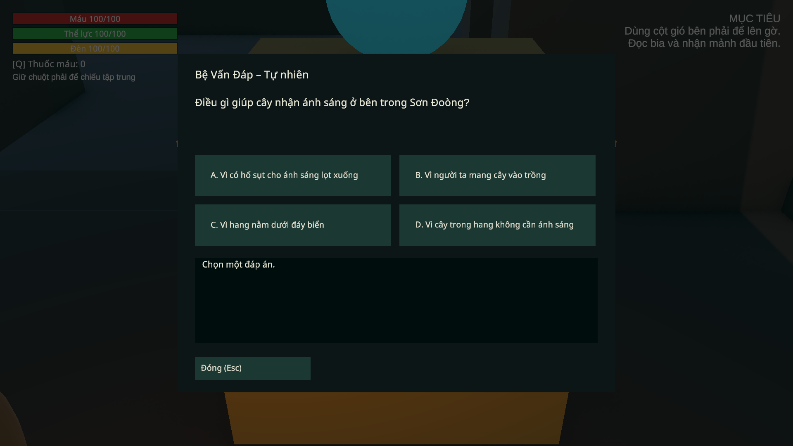
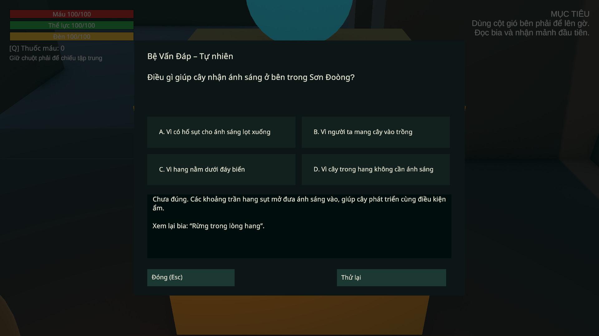
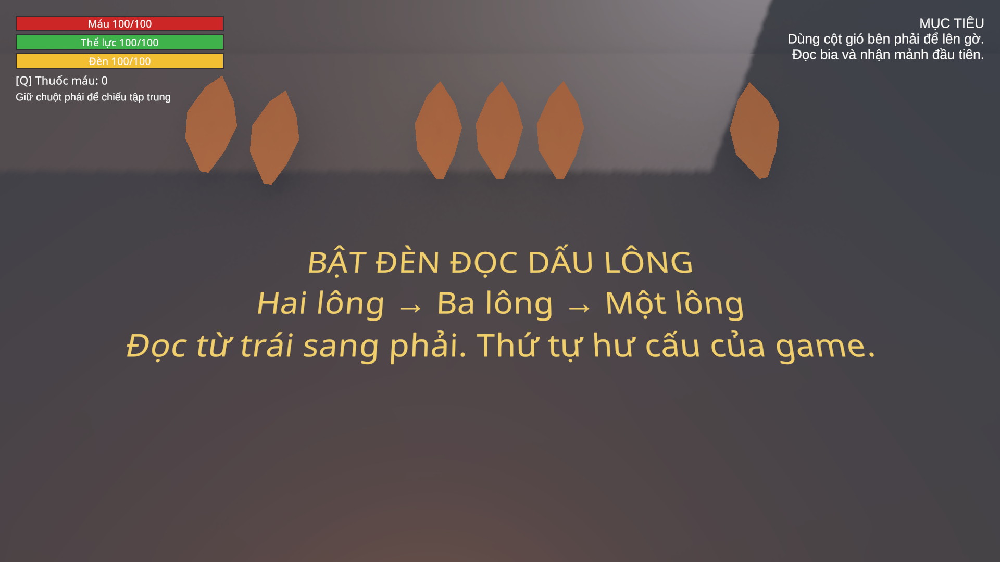
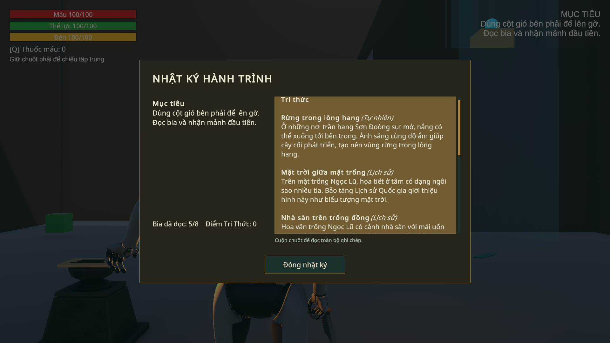

# C2 lượt3 — chuông, bia, câu hỏi và phần thưởng

Ngày **05/11/2026**, theo hàng đợi đã chốt. Scene `03_GiengTroiChimLac`; không thay model/rig An hoặc dựng C3. C2 vẫn là greybox, art/âm thanh toàn chương thuộc lượt7. Dùng model/bệ/vật liệu đã có và mesh lông do dự án tạo, không tải asset trả phí.

## Thay đổi

`World_Geometry/ART_C2_Knowledge` có giấy `c2_clue_bells` tại(5.8,13,28), đọc bằng E và xem lại trong Nhật ký. Ba chuông mang dấu một/hai/ba lông; phù điêu hiện dấu **2–3–1** khi đèn thường bật, trong5m và không bị vách chắn. Giấy giải thích cách đọc, vẫn cho tự giải. Giải chỉ mở cột gió cuối; P3 còn phải lên bệ và trả lời để nhận mảnh. P3 có `requiredPuzzleId=c2_pz_chuong_gio`. Không đổi ID/lời giải hoặc trigger cột gió. NavMesh C2 bake lại vào asset cũ sau khi đặt bệ giấy, giữ GUID.

Quiz UI C2 dùng card riêng: bốn lựa chọn trong hai hàng, giải thích có cuộn, nút Đóng và Thử lại tách khỏi nội dung. Khi sai, chặn lựa chọn cho tới Thử lại; Esc cho đóng và mở lại. API không nhận chỉ số đáp án ngoài0–3. Nguồn năm bia/bảy câu được đối chiếu trực tiếp, câu hỏi về tên hình tượng chim tránh khẳng định loài sinh học. Xem [bảng nguồn](C2_KNOWLEDGE_SOURCES.md). Sửa thẻ nhận lông và giấy đầu chương cho đúng vị trí: bia ở bên trái đáy giếng, bệ thưởng ở gờ cao.

`QuizPanel` bỏ static wrongThisSession; lần sai ghi Flags `quiz_wrong_<quizId>`. Answered và FirstTry công bố cùng batch. Cờ sai được lưu ở checkpoint, khôi phục như snapshot khác; không tự lưu khi sai. Save cũ đã Answered nhưng chưa có FirstTry không kiếm điểm mới khi nhận lại phần thưởng. Lỗi sai trước đây chưa từng được lưu không thể khôi phục ngược. Fresh world snapshot xóa phạt của lượt chơi trước. Schema4 và các ID hiện có giữ nguyên.

`RewardService.TryGrant` chuẩn bị tất cả item trên **cùng một bản nháp túi**, kiểm cả batch rồi commit inventory/world/claim trước khi phát event. Một loại không vừa hoặc ID/số lượng sai thì không trao gì. Claim `c2_ped_p*` nằm trong giao dịch; chặn thưởng lồng khi listener đang nhận thông báo và chặn nhận lại cùng claim. Bệ đã trả lời nhưng túi đầy vẫn giữ toàn bộ phần thưởng, cho nhận lại khi có chỗ mà không hỏi lại. Các helper internal mới nằm trong InventoryService và WorldStateStore; không đổi TryCraft/RestoreVersion.

## Kiểm chứng

[Apply Editor](reports/C2_Knowledge_Apply_2026-11-05.json) có16checks,0failures. [Kiểm tra Editor cuối](reports/C2_Knowledge_Editor_2026-11-05.json) có **23checks,0failures**, kiểm cấu hình/source, missing scripts, collider trang trí, đường NavMesh cạnh giấy và build gate bằng fixture verified=false khôi phục ngay trong bộ nhớ. Build gate không thay thế một lần build Windows.

[Play Mode](reports/C2_Knowledge_PlayMode_2026-11-05.json): **110checks,0failures,0runtime errors**. Bài thử opt-in `Chapter02KnowledgeProbe` dùng scene thật, API và `Button.onClick`, vị trí fixture, capsule/floor/ray vật lý; dừng AI/autosave trigger để cô lập. Không giả làm một lần chơi E/bàn phím hoặc toàn tuyến.

- Năm bia: vị trí đọc có nền/capsule trống, đèn tắt/hiện, vách tạm che thì ẩn, ra xa thì ẩn, mở toàn văn và ghi Nhật ký.
- Chuông: dấu đúng node, sai reset, tự giải khi chưa nhặt giấy, mở gió mà chưa tự nhận mảnh; giấy và bốn bệ có tia tương tác thông trong tầm3m.
- Quiz: sai/giải thích/đóng/mở/thử lại; chỉ số lỗi hoặc gọi đáp án khi đang chờ retry không tác động; đủ bốn bệ/bảy câu; double answer không gọi callback hay trao đồ lặp. Answered/FirstTry được observer đọc đồng thời.
- Giao dịch:11ô đầy và1ô trống, hai loại item riêng lẻ đều vừa nhưng cả batch không vừa; thất bại giữ nguyên túi/world/claim và không phát event. Đủ chỗ thì observer nhìn thấy toàn bộ đồ/world/claim, mỗi event một lần; gọi thưởng lồng và claim lặp bị chặn. Null/ID lạ/enum sai/số âm/tràn số lượng đều thất bại nguyên tử.
- P4 thực: túi12ô đầy → trả lời đúng → native SaveAt → menu/Continue còn đáp án và phần thưởng chưa nhận; giải phóng1ô → nhận đúng công cụ+2thuốc, không hỏi lại → SaveAt/Continue không nhân đồ.
- Sai P2 → lưu checkpoint → menu/Continue tạo scene/panel mới → đúng vẫn không có FirstTry. JSON native có cờ sai; giấy/lore/chuông giữ nguyên. Snapshot mới cho điểm lại đúng luật. Đây là reload scene qua Continue, **chưa khởi động lại process Windows**.

Save cá nhân primary/bak/tmp được backup trước fixture và trả **byte-for-byte** sau mỗi lượt. Lần chạy đầu dừng vì assertion tìm chữ B vô tình khớp chữ “Ba” trong prompt tiếng Việt; sửa assertion đối chiếu đầy đủ prompt, giữ report lần đó ở `Logs/C2Knowledge-attempt1.json`. Không bỏ kiểm hoặc sửa dữ liệu game để làm phép thử này đạt.

## Tiếp nối

Backup trước sửa: `SourceAssets/SceneBackups/2026-11-05_C2Knowledge/192230`; manifest `Logs/C2Knowledge-backup.json`. Công cụ Editor `Chapter02KnowledgeSetup` nhận request `Library/SonDoongC2Knowledge.request.json`, action apply/inspect/validate/test; từ chối Play hoặc scene người dùng chưa lưu. Kiểm chứng cuối/SHA/save/meta ở [Delivery](reports/C2_Knowledge_Delivery_2026-11-05.json), [Editor state](reports/C2_Knowledge_EditorState_2026-11-05.json).

Sau lượt3, phần tiếp nối là lượt4; hiện đã đạt tại [C2_BRIDGE_WORKLOG](C2_BRIDGE_WORKLOG.md), hàng đợi mới nhất ở PROJECT_STATUS. Chưa thử full P4/P5, nhịp chiến đấu hoặc Windows mới. QuizSequence cuối C2/save lỗi vẫn chờ lượt6. Nguồn C1 chưa được xác minh trong đợt này; gate nội dung chỉ bao phủ C2. Bản Windows C1 trước đây chưa chứa các thay đổi C2 hiện tại.
