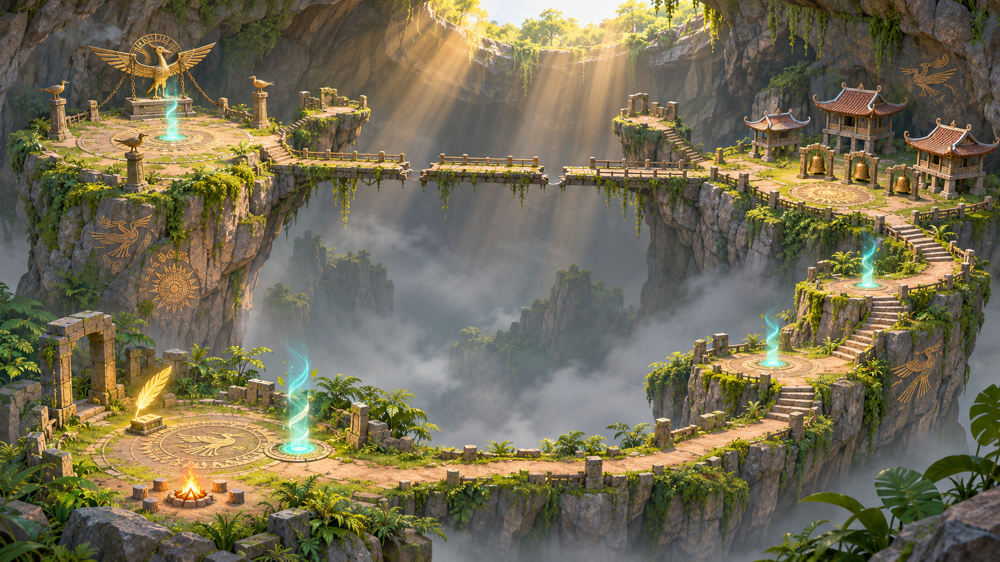
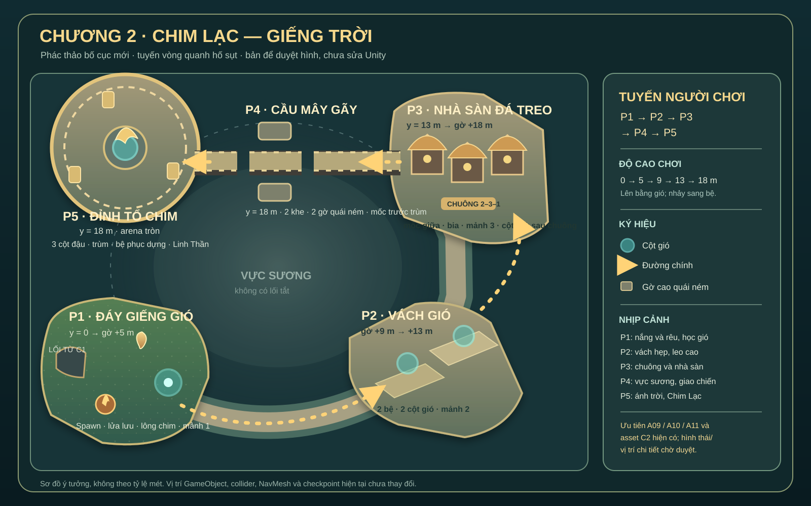

# Đề xuất bản đồ Chương 2 — Chim Lạc: Giếng Trời

**06/11/2026 · Chờ người dùng duyệt hình · Chưa sửa scene.** Bố cục này là đề xuất mới theo yêu cầu ngày 06/11, không phải sơ đồ tọa độ của `03_GiengTroiChimLac.unity` hiện tại.

## Ý tưởng không gian

Tuyến đi vòng quanh một hố sụt trung tâm: **P1 tây nam → P2 đông nam → P3 đông bắc → P4 băng ngang vực về phía tây → P5 tây bắc**. Từ P1 luôn nhìn thấy đích cao nhất và ít nhất một bệ gió kế tiếp. P4 là lần duy nhất phải vượt vực; hai khe cầu có tín hiệu nhìn rõ. P5 mở rộng thành vòng tròn đủ chỗ đọc đòn lao và gió đẩy của Chim Lạc. Vực trung tâm là ranh giới hình ảnh, không thêm đường tắt gameplay.

| Khu | Vai trò và mốc không đổi | Hình ảnh đề xuất |
| --- | --- | --- |
| P1 Đáy Giếng Gió | Spawn, lửa lưu, Lông Chim Lạc, học cột gió, bia/bệ và mảnh 1; sàn 0 m, gờ 5 m | Nắng xiên, rêu và dương xỉ tập trung ở mép; lối tới cột gió đọc được từ spawn |
| P2 Vách Gió | Hai cột gió, hai bệ cao 9/13 m, bia/bệ và mảnh 2 | Đường men vách, nhịp thẳng đứng; từng điểm đáp không bị cây che |
| P3 Nhà Sàn Đá Treo | Mốc giữa, ba chuông thứ tự 2–3–1, phù điêu, cột cuối, bia/bệ và mảnh 3; sàn 13 m, gờ 18 m | Ba nhà sàn mái cong có hình riêng nhưng chuông ở cùng tầm nhìn; ánh đồng ấm |
| P4 Cầu Mây Gãy | Hai khe cầu, hai Hắc Ảnh tuần tra, hai Hắc Ảnh Ném trên gờ, bia/bệ nhận công cụ, mốc trước trùm và cửa; cao 18 m | Cầu hẹp kéo ngang toàn hố; gờ quái ném ở hai bên, biển báo gió/đá trước khe |
| P5 Đỉnh Tổ Chim | Arena tròn, ba cột đậu, cột gió trung tâm, Chim Lạc, bệ phục dựng, ba câu Linh Thần và lối kết; cao 18 m | Nắng mạnh hơn, vách mở và hoa văn chim–mặt trời hư cấu; vùng đánh nhìn rõ |

Mảnh/cơ chế/ID, checkpoint, quái và chuỗi nhiệm vụ theo [đặc tả C2](../spec/chapters/C2_Chim_Lac.md). Bố cục vòng là thay đổi về địa hình/tọa độ, nên nếu được duyệt sẽ cần lập bảng chuyển vị trí GameObject, collider, đường NavMesh, checkpoint và góc camera trước khi sửa scene. Hình phối cảnh là **ý tưởng mỹ thuật**, không phải ảnh chụp Unity hay mô hình độ dài/cao độ chính xác; sơ đồ SVG ghi mốc gameplay rõ hơn và cũng không theo tỷ lệ mét.

## Ưu tiên asset có sẵn

| Nhu cầu | Asset đã có |
| --- | --- |
| Vách hang, đá, sườn giếng | `Assets/A09 - Mines and Cave Set/`, mesh đá/vách trong `Assets/_Project/Art/Chapter02Environment/` |
| Cầu, trụ, lan can, lát đá | `Assets/A10 - Ultimate Modular Ruins Pack/`, gồm `BridgeSection.fbx` và `Column_BridgeSupport.fbx` |
| Cây, bụi, cỏ, rêu | `Assets/A11 - Ultimate Stylized Nature Pack/` và material URP C2 hiện có |
| Mái cong, chuông, gió, bệ/cổng | Mesh `Curved_House_Roof.asset`, `Bronze_Wind_Bell.asset`, prefab cột gió/chuông và bệ/cổng đã dùng trong scene C2 |
| Chim Lạc | `ChimLacPresentation` và mesh cách điệu C2 hiện tại là hình chiến đấu tạm; chưa có bằng chứng về model/rig sinh vật cuối |

Chưa có lý do nhập thêm asset cảnh quan/kiến trúc ở bước duyệt bản đồ. Nếu cần thay model Chim Lạc sau khi duyệt hình, thử model miễn phí và kiểm rig, animation, quyền dùng, hình thái, URP và khả năng phù hợp với FSM hiện tại trước. Ứng viên tham khảo, **chưa nhập**:

- [Stylized bird — Sketchfab, CC BY](https://sketchfab.com/3d-models/stylized-bird-a9fe3d83b94d4d249d1597537de018ee): model có rig theo trang, cần kiểm animation và khả năng đổi hình.
- [Low Poly Bird (Animated) — Sketchfab, CC BY](https://sketchfab.com/3d-models/low-poly-bird-animated-82ada91f0ac64ab595fbc3dc994a3590): có rig/animation theo trang, cần đánh giá mức chi tiết và silhouette của trùm.
- [Sparrow – Quirky Series — Sketchfab, CC BY](https://sketchfab.com/3d-models/sparrow-quirky-series-289e7db66cfa45fbbe7624b8f48f6c8c): có nhiều clip/LOD theo trang, nhưng tạo hình dễ thương có thể không hợp Chim Lạc.

Hoa văn/nhà sàn trong hai hình là **cách điệu hư cấu lấy cảm hứng Việt Nam**, không được coi là phục dựng khảo cổ. Chuẩn thực thi nếu duyệt: Mid Poly Stylized Việt Nam, texture 1K mặc định/2K cho công trình chính và nhân vật, URP Lit, LOD cho vật lớn theo [Art Bible](ART_BIBLE.md).

## Trạng thái kiểm tra

Đã đối chiếu đặc tả C2, worklog môi trường, ảnh Game View cũ và tệp asset trên đĩa. SVG đã parse XML thành công. Chưa kiểm tra scene/dirty state/Console trực tiếp vì Unity MCP không có trong bộ tool của phiên này; chưa mở Play Mode, sửa Unity, nhập asset hoặc chạy build. Scene C1 dirty mà người dùng nêu được giữ nguyên.
