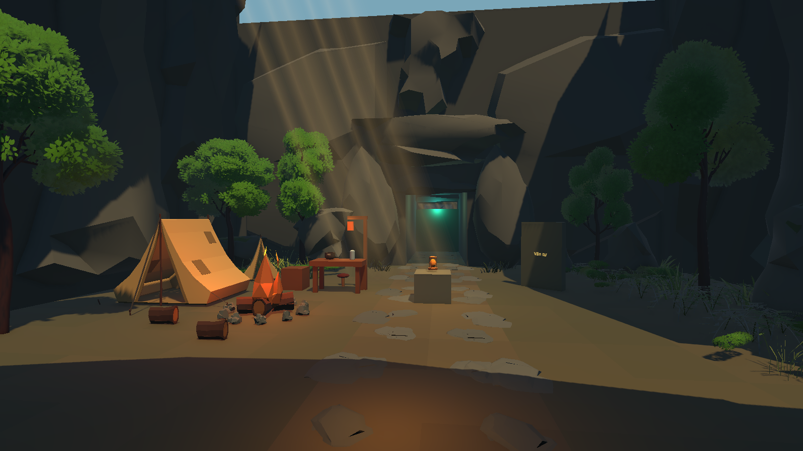
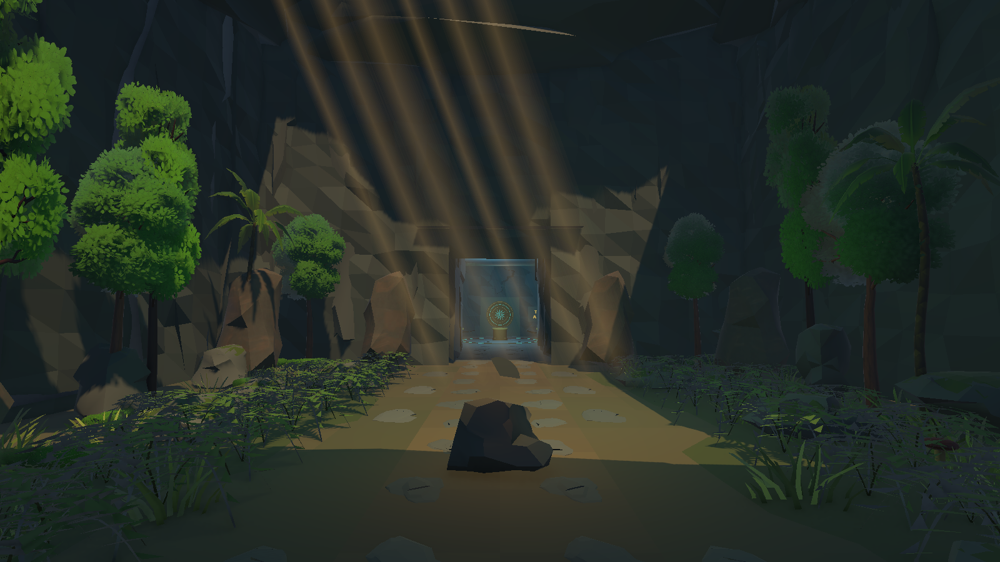
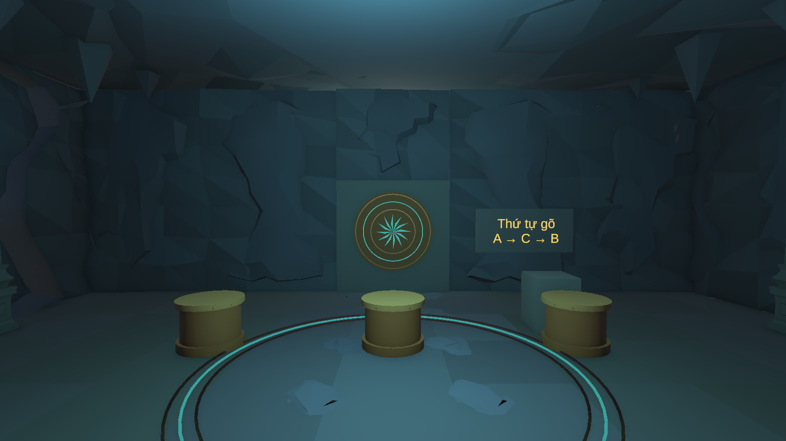
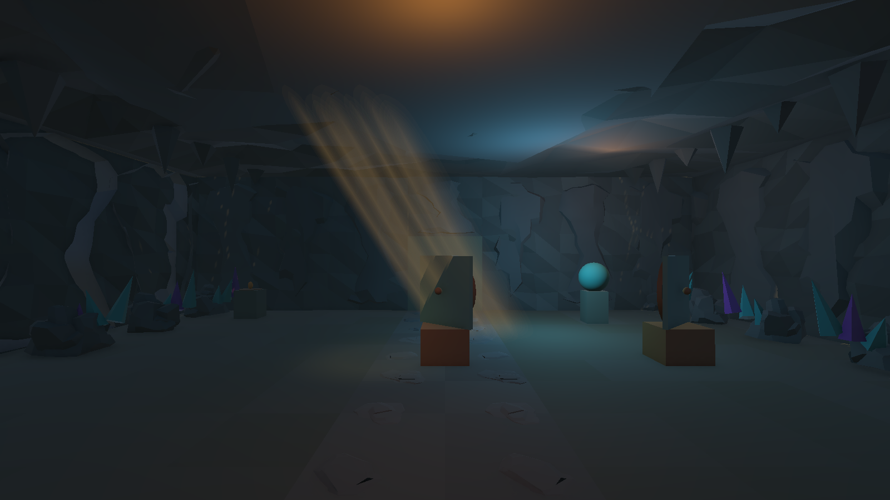
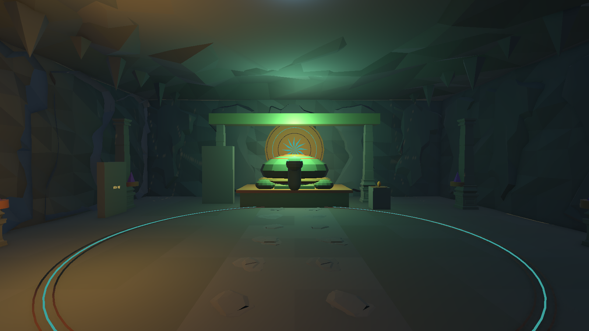

# Bối cảnh chương 1 — 04/11/2026

**Mốc lịch sử:** bản mới nhất ngày 05/11 đã mở rộng địa hình và làm lại đường nối theo yêu cầu mới. Đọc [CHAPTER01_EXPANDED](CHAPTER01_EXPANDED.md) và PROJECT_STATUS trước; ràng buộc giữ footprint/collider cũ và tọa độ dưới đây thuộc bản ngày 04/11.

Yêu cầu mới nhất: dựng lại **toàn bộ năm khu chương 1** theo năm ảnh người dùng gửi, sửa đá/cỏ lệch nhau và chỉ dùng asset miễn phí. Phong cách vẫn là **3D hoạt hình low poly** đã chọn; ảnh mới dùng cho bố cục, nhịp sáng và không khí. Không chuyển game sang đồ họa photorealistic, không thêm chương hoặc nhân vật/quái mới.

## Bản dựng

| Khu | Cách thể hiện |
| --- | --- |
| Trại Giếng Trời | Giữ trại và khoảng đứng tương tác; nền đất/đá, rêu bám tảng đá, dương xỉ, nắng ấm dưới giếng trời, lửa trái/bàn riêng/lối đi rõ. |
| Vườn Rêu | Vách đá phân lớp cao, mép giếng trời, cây lá rộng/cọ, cây thấp và dương xỉ theo cụm; giữ khoảng giữa và đường vòng bệ mảnh A. |
| Điện Trống | Vách/trần hang khép kín, nhũ đá, cột đá A10, trống màu đồng, vòng khảm lam và hình mặt trời trên cửa. Hình trên cửa biến mất cùng cửa khi giải xong. |
| Hành Lang Quang | Đá lạnh, cụm tinh thể lam/tím ở rìa, tia nắng ấm, gương có khung đồng; giữ nguyên mặt quang học, hướng gương và beam gameplay. |
| Đàn Kim Quy | Tượng rùa tĩnh bằng mesh của dự án, bệ/cột đá, vòng khảm, hậu cảnh mặt trời, ánh ngọc và điểm ấm. Hộ vệ vẫn là actor hiện có, tách khỏi tượng trang trí. |

Giữ tuyến và mặt nền/collider bản khối, không thêm vực hay cầu bắt buộc khiến người chơi phải đổi tuyến. Nền đồ họa chồng dưới chân vách để tránh hở sáng. Vách có mặt đá phân lớp, trần có mesh gồ và nhũ đá; các chi tiết này không phải hang đo đạc ngoài thực địa.

## Sửa tiếp xúc và va chạm

- Tắt các `MossCrown_*` cũ đặt bằng độ cao ước lượng. Tạo **23 mesh rêu** bằng raycast trực tiếp lên tam giác của từng tảng đá; offset nhỏ khỏi mặt đá.
- Cây/cỏ đặt theo `Renderer.bounds.min.y`, chân cây chôn nhẹ vào nền; dương xỉ tự dựng có cuống chạm đất. Công cụ kiểm tra bounds khi dựng và khi đọc lại scene.
- Giữ collider gốc. Thêm **17 collider đơn giản** cho tám tảng đá rìa Vườn Rêu, bảy thân cây và hai phần bệ/tượng; cây thấp, lá, rêu, tinh thể và tia nắng không có collider. Collider nguồn nhập được tắt trên instance.
- Bake lại `NavMeshSurface` theo **Physics Colliders**, lưu asset riêng của lượt art. Không lấy mặt lá/cỏ làm vật cản NavMesh.
- Mesh tương tác nằm dưới object chứa script. ID, tham chiếu, spawn, damage, AI, save schema và tiến trình giữ nguyên. Công cụ so sánh serialization của các component gameplay/collider cũ trước/sau; riêng NavMeshSurface được cập nhật dữ liệu bake.
- Tượng cùng hai collider mới nằm dưới `Altar_TrongDong/VIS_C1_KimQuy_Statue`, để collider mới vẫn trả về `RelicAltar` khi ngắm E. Giữ nguyên điều kiện chỉ phục dựng sau khi thắng Hộ vệ; không thêm proxy tương tác hay ID mới.

## Scene và tệp

- Preview: `Assets/_Project/Scenes/92_EnvironmentPreview.unity` nay là bản thử **toàn chương**, sao chép các object gameplay hiện có để kiểm tra cấu hình, không phải preview trại riêng trước đây.
- Main: `Assets/_Project/Scenes/02_HangLinhMach.unity`.
- Nhóm trang trí mới: `World_Geometry/ART_C1_Environment/ENV_01_Camp_ContactFix`, `ENV_02_MossGarden`, `ENV_03_DrumHall`, `ENV_04_LightCorridor`, `ENV_05_KimQuy`. `ENV_01_Camp/ART_Camp` cũ vẫn giữ; nhóm mới sửa tiếp xúc và bổ sung nền/cây cho trại.
- Mesh/material/prefab/shader dự án: `Assets/_Project/Art/Chapter01/`. Prefab `PF_ART_C1_Environment` chứa trang trí chung; model tương tác nằm riêng dưới gameplay root, không sao chép chỉ prefab này để thay toàn màn.
- Công cụ Editor: `Assets/_Project/Editor/Chapter01EnvironmentSetup.cs`, menu `Tools/Son Doong/Chapter 01 Environment`; menu `Tools/Son Doong/Chapter 01 Environment`; chỉ chạy khi có request tường minh trong `Library/SonDoongChapter01Art.request.json`. Không tự ghi cảnh lúc import. Từ chối Play Mode, scene chưa lưu và ghi đè art đã tích hợp.
- Sao lưu scene và `.meta`: `SourceAssets/SceneBackups/2026-11-04_Chapter01Art/`. Các bản gốc trước mỗi lượt thử được giữ ngoài Assets để không nhập trùng GUID.

## Asset miễn phí

Đã có đủ asset để dựng lượt này; **không yêu cầu tải thêm bộ trả phí hoặc asset mới**. A09 Mines and Cave Set cho đá; A11 Ultimate Stylized Nature Pack cho cây/cỏ/đá; A16 Survival Pack cho trại/đạo cụ; bổ sung cột trung tính của A10 Ultimate Modular Ruins Pack đã có sẵn. Không nhập nhân vật hoạt hình, súng hoặc bẫy trong những bộ này vào cảnh.

Trang chính thức của [A10](https://quaternius.com/packs/ultimatemodularruins.html), [A11](https://quaternius.com/packs/ultimatestylizednature.html) và [A16](https://quaternius.com/packs/survival.html) được đối chiếu 04/11/2026, ghi CC0 và dùng miễn phí cho dự án cá nhân/thương mại. Giữ file license của bản nhập. Riêng khác biệt README/nguồn A09 và tiêu đề license A11 đã ghi trong [CAMP_ENVIRONMENT](CAMP_ENVIRONMENT.md), không đổi nguồn nhập để che khác biệt.

Dương xỉ, rêu bám mặt, mặt đá/nền, nhũ đá/tinh thể, hình khảm, tượng rùa và shader tia nắng được dựng bằng mã/mesh trong dự án. Đây là hình trang trí hư cấu, không tự nhận là hoa văn hay tượng khảo cổ xác thực. Tia nắng dùng card alpha mềm URP, không yêu cầu HDRP hoặc gói volumetric có phí.

## Kiểm chứng

Đã đạt **145 checks Play Mode, 0 failures/errors**; Editor kiểm tra 143 cụm cây chạm nền, 23 mảng rêu và giữ nguyên tham chiếu gameplay. Kết quả cuối và các giới hạn được cập nhật sau lượt kiểm tra trong [PROJECT_STATUS](PROJECT_STATUS.md). Báo cáo Editor nằm trong `docs/reports/Chapter01Art_Editor_2026-11-04.json`; Play Mode trong `Chapter01Art_PlayMode_2026-11-04.json`. Phép thử Play dùng controller/API, cô lập AI lúc đo đường đi; không thay cho người thật đánh trùm hoặc duyệt cảm giác đồ họa.

Bản Windows riêng: `Builds/Chapter01Environment/Windows/SonDoong.exe`, build thành công 0 lỗi/485 cảnh báo shader package Sentis. [Bằng chứng build](reports/Chapter01Art_Build_2026-11-04.json); xác nhận binary chứa model tượng dưới altar và loại probe Editor khỏi assembly.

Chưa chứng nhận FPS trên máy tham chiếu, chưa bake GI toàn chương, chưa chơi tay toàn bộ Windows build. Kết quả art và ảnh engine không tự chứng minh các mục này đã hoàn thành.

## Ảnh kiểm tra từ tầm mắt

Các ảnh `c1-main-*` dùng camera Editor thấp trong scene chính; ảnh `c1-play-*` dùng camera gameplay hiện có. Ảnh Editor ẩn actor khi chụp để xem bối cảnh; không tắt actor trong scene đã lưu.

