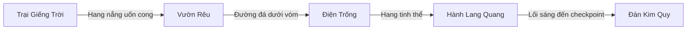

# Chương 1 mở rộng — 05/11/2026

Yêu cầu mới cho phép dựng lại địa hình của `02_HangLinhMach`, mở rộng không gian và làm đường nối giữa năm khu. Ràng buộc giữ kích thước bản khối trong lượt Trại cũ đã được thay ở phạm vi này. Giữ thứ tự chơi, ID, tham chiếu tương tác, hai puzzle và hệ save; không tạo nhân vật/quái mới.

## Bố cục

| Khu | Tâm X/Z (m) | Kích thước danh nghĩa | Chiều cao hang |
| --- | --- | --- | --- |
| Trại Giếng Trời | 0 / 0 | 36 × 36 m | 22 m |
| Vườn Rêu | 18 / 70 | 48 × 48 m | 25 m |
| Điện Trống | −14 / 145 | 40 × 38 m | 16 m |
| Hành Lang Quang | 25 / 215 | 48 × 42 m | 19 m |
| Đàn Kim Quy | 0 / 290 | 46 × 44 m | 21 m |

Kích thước là ellipse danh nghĩa; biên hang có độ lệch bất quy tắc. Trục dọc toàn màn khoảng 330 m, thay cho bản cũ khoảng 118 m. Bốn lối nối uốn cong có nền liên tục rộng 10,5 m, lòng hang khoảng 8,4–9,6 m và dải đường giữa 4,5 m. Mép đường có đá, dương xỉ, trụ dẫn sáng; một số khe vòm đón ánh sáng. Đây là mở rộng không gian, chưa phải đo thời lượng trải nghiệm người mới.

Trại giữ lửa bên trái và bàn chế tách riêng. Vườn tập trung cây dưới giếng trời và các cụm đá giữa khoang. Điện Trống dùng phù điêu trống đồng làm điểm nhìn. Hành Lang Quang dùng xanh lam/tím và các trụ cổ. Kim Quy giữ vùng chiến đấu thoáng, điểm nhìn là tượng/bệ cuối hang. Nền chính bằng phẳng để giữ điều khiển; hình khối, vách, cây và vòm tạo cao độ thị giác.

## Scene và object

- Cảnh mới: `World_Geometry/ENV_C1_ExpandedWorld`, bên dưới có `ENV_01_TraiGiengTroi` đến `ENV_05_DanKimQuy`, bốn nhóm `LINK_…` và `Lighting_ExpandedC1`.
- Hình cảnh cũ lưu nguyên trong các nhóm inactive dưới `World_Geometry`; không bật đồng thời. Những root gameplay trước đây nằm trong hình cảnh đã được chuyển sang `Gameplay` trước khi tắt nhóm cũ.
- Công cụ: `Assets/_Project/Editor/Chapter01ExpandedLayout.cs`. `stage` tạo preview từ main cũ; `apply` chỉ dùng trước khi main đã có nhóm mới. Công cụ từ chối scene đang dirty/Play Mode và từ chối dựng đè thế giới đã mở rộng.
- Vật liệu/mesh/texture bản dùng trong dự án: `Assets/_Project/Art/Chapter01Expanded`. Texture bản sao nhập ở mức tối đa 1K; không sửa nguồn nhập.
- Vách và nền dùng MeshCollider; đá/trụ lớn dùng collider đơn giản; cây chặn thân; cây thấp và chi tiết lát nền không có collider riêng. NavMesh được bake lại bằng Physics Colliders trong một scene duy nhất.
- `Authoring_RouteGuides` inactive, tag `EditorOnly`, chỉ phục vụ phép thử; không đưa vào bản Windows.
- Backup scene và `.meta`: `SourceAssets/SceneBackups/2026-11-05_ExpandedC1/`. Giữ GUID của hai scene.

## Gameplay được căn lại

Các khu dịch theo nhóm; khoảng cách hai gương vẫn 5 m. Không đổi các ID `relic_drum_*`, puzzle, pickup, lantern hoặc save schema. Các cổng puzzle có vách chắn đầy chiều ngang để không đi vòng qua sau khi mở rộng hang. Cửa đóng hẹp được căn rộng tối thiểu 3,4 m để phủ khe vách 3 m; giữ object/collider/script gốc và cách puzzle mở cửa.

| Checkpoint | Spawn X/Y/Z mới |
| --- | --- |
| `cp_trai` | 0 / .2 / −5 |
| `cp_dien_trong` | −17 / .2 / 139 |
| `cp_truoc_dan` | 8 / .2 / 263,5 |
| `cp_kim_quy` | 5,5 / .2 / 304,5 |

Phong ấn trại ở Z20, cổng đủ điều kiện ở Z270, bệ cuối ở Z307. Giới hạn di chuyển Hộ vệ được căn theo đấu trường mới; thông số đòn đánh không đổi. Continue native lưu theo checkpoint ID sẽ dùng spawn mới. Không đổi ID riêng lẻ để khớp tên thiết kế.

## Asset và ghi công

Dùng asset đã có: A09 Mines and Cave Set; A10 Ultimate Modular Ruins; A11 Ultimate Stylized Nature; A14 Mossy Rock; A15 Ground 037; A16 Survival; A20 Trống đồng. Các mesh hang, đường, dương xỉ và tinh thể bổ sung được dựng trong dự án. Không cần thêm gói trả phí.

**A20:** “Trống Đồng Đông Sơn (Dong Son bronze drum)” — **Aaannnn**, [model nguồn trên Sketchfab](https://sketchfab.com/3d-models/trong-ong-ong-son-dong-son-bronze-drum-c91e55f6db8742f09ad2d5815ca6b749), giấy phép hiển thị **CC Attribution**. Thay đổi: vật liệu URP, base color và normal map bản sao tối đa 1K, kích thước/hướng để làm phù điêu và hình phục dựng. Không ghi thành CC0; thông tin phiên bản CC cụ thể chưa được trang trả rõ trong lượt kiểm tra. Credit đi kèm bản Windows trong `CREDITS.txt`.

A14 [Mossy Rock](https://polyhaven.com/a/mossy_rock) và A15 [Ground 037](https://ambientcg.com/view?id=Ground037): CC0 theo danh mục nguồn dự án. A10/A11/A16: Quaternius CC0 theo danh mục. A09 giữ điều kiện Asset Store của gói đã nhập. Danh mục không thay thế việc giữ giấy phép nguồn khi phân phối dự án.

A13 là atlas UV có phần đệm đen, không dùng lặp trên vách/đường. Bản hiện hành dùng bề mặt A14 có thể lặp; tránh dải đen và hình UV vỡ khi trải trên mesh mới.

## Ảnh và kiểm chứng

Ảnh từ camera tham chiếu đã lưu; ảnh thực tế trong Play Mode ở `c1-expanded-play-*`. Kết quả kiểm tra và build được cập nhật trong PROJECT_STATUS.

- [Trại Giếng Trời](images/c1-expanded-main-camp-2026-11-05.png), [Vườn Rêu](images/c1-expanded-main-garden-2026-11-05.png), [Điện Trống](images/c1-expanded-main-drums-2026-11-05.png).
- [Hành Lang Quang](images/c1-expanded-main-light-2026-11-05.png), [Đàn Kim Quy](images/c1-expanded-main-kimquy-2026-11-05.png), [toàn tuyến từ trên cao](images/c1-expanded-main-overview-2026-11-05.png).
- Đường nối [Trại–Vườn](images/c1-expanded-main-link1-2026-11-05.png), [Vườn–Điện](images/c1-expanded-main-link2-2026-11-05.png), [Điện–Quang](images/c1-expanded-main-link3-2026-11-05.png), [Quang–Đàn](images/c1-expanded-main-link4-2026-11-05.png).

Đường có lớp đá lát chia viên ghép theo đường cong, dùng bốn sắc đá và 36 mesh gộp; chi tiết lát không có collider riêng. Collider nền giữ đường đi liên tục. Điện Trống có phù điêu A20 gắn trên bệ đỡ vách, vật liệu dùng thêm normal map gốc bản sao 1K; Kim Quy có mái cong màu đá xanh. Số renderer world có trong báo cáo Editor, đây không phải draw call/FPS.

[Play Mode](reports/ExpandedC1_PlayMode_2026-11-05.json): **569 checks, 0 failures, 0 runtime errors**, gồm 56 góc camera, đi qua bốn đường nối, chế/lưu riêng, hai puzzle (có tia phản xạ thật), ba mảnh, cổng, Continue và rơi chết/hồi sinh ở spawn mới. Save gốc được trả byte-for-byte. Kiểm tra Editor còn đo nền/khoảng trống tại 206 mẫu đường, vách chặn tại 149 mặt cắt và metadata/GUID hai scene. Đá rìa tại hai cửa hang đã được dời cùng collider; bệ trống/cụm đá trong phòng được đi vòng theo mặt đường.

[Editor cuối](reports/ExpandedC1_Editor_2026-11-05.json), [GUID](reports/ExpandedC1_Metadata_2026-11-05.json), [Windows build](reports/ExpandedC1_Build_2026-11-05.json), [SHA và thông tin bàn giao](reports/ExpandedC1_Delivery_2026-11-05.json). Bản Windows ở `Builds/Chapter01Expanded/Windows/SonDoong.exe`: thành công, 0 lỗi, 485 cảnh báo shader của AI Inference/Sentis. Giữ toàn bộ thư mục Windows khoảng 275 MB khi chạy/chuyển máy. Bản build gồm lượt normal map, bệ đỡ phù điêu và mái cuối; chưa chơi tay Windows.

Ảnh [camera người chơi tại spawn](images/c1-expanded-play-spawn-2026-11-05.png) ghi actor prototype hiện hành trong cảnh mới. Các ảnh `main` dùng camera tham chiếu không actor để xem rõ bố cục. Lượt hiển thị cuối chỉ đổi vật liệu/đèn và thêm chi tiết cao không collider; đã kiểm Editor lại sau 569 checks, không áp kết quả đó thành phép thử combat thủ công.

Giới hạn cần giữ khi duyệt: actor còn prototype; chưa bake GI, chưa đo FPS/máy thứ hai, chưa nghiệm thu chiến đấu trùm bằng người chơi. Phép thử hình học tắt AI để đo đường, dùng API tương tác/puzzle và kiểm tra tia quang học thật; không thay thế chơi tay.
