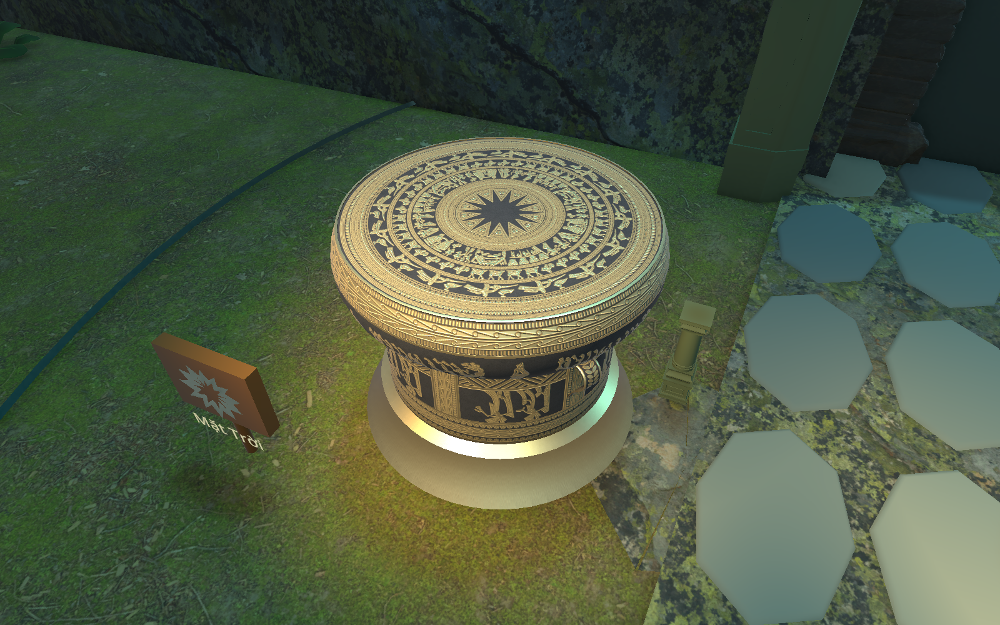
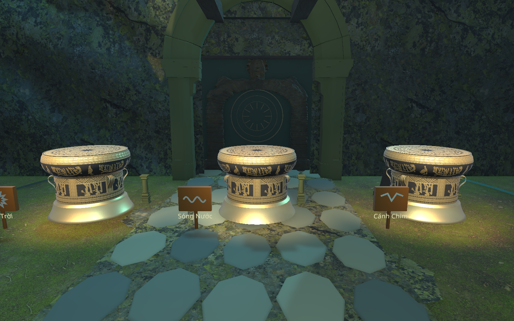

# Ba trống Đông Sơn tại Điện Trống —06/11/2026

Người dùng gửi `C:/Users/ACER/Downloads/trong-ong-ong-son-viet-nam.zip` và yêu cầu thay ba trống giải đố bằng model có hoa văn Việt rõ nét. Đã áp vào **92_EnvironmentPreview trước, rồi 02_HangLinhMach**. Không thay nhân vật, ba mảnh cổ vật, trống phục dựng ở đàn, cơ chế/âm gõ hoặc chương2.

## Model và vật liệu

[Trống đồng Đông Sơn – Việt Nam](https://sketchfab.com/3d-models/trong-ong-ong-son-viet-nam-21e418a517a74b49a17ebbad94ba26c0), tác giả [ndnguyen3d](https://sketchfab.com/ndnguyen3d), **[CC BY4.0](https://creativecommons.org/licenses/by/4.0/)**. API công khai của Sketchfab đã trả tác giả/license/downloadable, lưu [bản ghi](reports/DongSonDrums_Source_2026-11-06.json). Mô tả trên trang là thông tin của tác giả; dự án không tự xác nhận đây là bản quét một hiện vật bảo tàng cụ thể.

FBX và năm PNG2K nguồn giữ nguyên bytes trong `Assets/_Project/Art/DongSonDrum/Source`. Unity import có19mesh, tổng13.340vertices sau tách UV và9.712triangles; không chủ động decimate hoặc vẽ lại hoa văn. Đây là số đọc từ mesh Unity, khác trường faceCount9.892 của trang nguồn. UV/normals nguồn giữ, tangent MikkTSpace. Model dùng chiều cao1,12m, chân ởY0,12m, giữ tỷ lệ thế giới đồng đều; root gameplay cũ vẫn có scaleY0,4 và được visual wrapper bù lại.

`Materials/DongSon_EngravedBronze.mat` dùng URP/Lit: BaseMap màu gốc2K, normalBC5, metallicBC7/R và alpha smoothness=1−roughness, hệ số smoothness0,68; mipmap/trilinear/aniso16. Texture metallic/roughness đọc tuyến tính; bản ghép `Textures/Metallic_Smoothness.png` là dẫn xuất kỹ thuật, không tô lại hoa văn. Height nguồn lưu lại, không thêm displacement/collider. Texture/material dùng chung cho cả ba trống.

Mỗi trống có `ART_Drum_ReadingLight` spot màu ấm, intensity22/range6m, không shadow. Bảng tên/ký hiệu nhỏ đưa sang bên trái và hạ thấp, có chân đỡ, tránh che mặt/thân trống và tránh nền đá che chữ. Vẫn dùng Mặt Trời/Sóng Nước/Cánh Chim; không hiện A/B/C. Không đổi các vị trí trống hoặc mở rộng đường đi.

Credit ở `Assets/_Project/Art/DongSonDrum/ATTRIBUTION.txt` và [credit C1](CHAPTER01_ASSET_CREDITS.txt). Đây là model **khác A20 Aaannnn**; A20 vẫn giữ các công dụng trang trí/phục dựng trước đó.

## Cấu trúc và an toàn

`DongSonDrumSetup` chỉ nhận lệnh rõ qua `Library/SonDoongDongSonDrums.request.json`: prepare/apply/inspect/render/test. Không chạy tự động khi mở game. Chặn Play Mode hoặc scene người dùng chưa lưu trước authoring. Backup scene/meta gốc ở `SourceAssets/SceneBackups/2026-11-06_DongSonDrums`.

Thay riêng cây `VIS_DongSon_Playable` dưới `Drum_A/Drum_B/Drum_C`, giữ nguyên `DrumInteractable`, `DrumPuzzleController`, collider root, ref puzzle/indicator/audio, thứ tự A→C→B và ID `pz_trong_01`, giấy/Journal/schema4. Đồ trang trí ở layer Ignore Raycast, không thêm collider. Không bake NavMesh. Không sửa nguồn asset cũ hoặc prefab gameplay.

Không dùng công cụ author cũ `Chapter01RevisionArt.Install` để áp lần thay này: đường dựng trống cũ vẫn là A20. Khi cần áp lại, dùng công cụ scoped `DongSonDrumSetup` và đọc yêu cầu06/11 trong MEMORY.

## Kiểm chứng

- [Editor12 mục](reports/DongSonDrums_Editor_2026-11-06.json),0failures: ba model/URP PBR trong cả hai scene; collider tương tác/ref puzzle còn, không collider visual mới, không missing script. Ảnh chụp lại sau căn bảng và thêm chân đỡ.
- [Play Mode33 mục](reports/DongSonDrums_PlayMode_2026-11-06.json),0failures/0errors: Boot/NewGame, đủ ba FBX và PBR, ray từ vị trí mắt hợp lý chọn đúng collider, prompt tiếng Việt, gõ sai/reset/debounce, world update không xóa nhịp dở, chuỗi đúng mở cửa/hiện thưởng, ngăn gõ lại, native SaveAt/menu/Continue giữ solved và model. Save primary/bak/tmp được trả nguyên bytes/trạng thái không tồn tại.
- Bài Play dùng **API production**, vị trí và prerequisite đèn/phong ấn là fixture; AI cô lập, giữ collider. Không gọi đây là E tay, toàn tuyến hoặc nghiệm thu người mới. Lượt đầu fixture thiếu đèn/phong ấn bị SaveService từ chối đúng; sửa fixture, không nới validator hay đổi gameplay. Log lượt đầu giữ ở `Logs/DongSonDrums-probe-before-fixture-fix.json`.
- [Delivery40 mục](reports/DongSonDrums_Delivery_2026-11-06.json),0failures: sáu file nguồn bằng ZIP, meta/GUID asset mới hợp lệ, backup scene khớp SHA đầu phiên, scene meta và **toàn bộ override prefab puzzle đang có** giữ nguyên, save cá nhân khớp; C2scene/NavMeshC1/PlayerMotor/hai script trống giữ SHA. Script kiểm đọc lại: `python SourceAssets/Tools/dongson_drum_audit.py`.
- [Editor cuối](reports/DongSonDrums_EditorState_2026-11-06.json): dừng Play, không compile, sceneBoot sạch. Có thể bấm Play từ Boot để thử tuyến bình thường.

Chưa build lại Windows trong lượt thay model này; executable lượt C2 trước đó chưa chứa ba trống mới. Chưa nghiệm thu người chơi mới/Low bằng tay, âm gõ vẫn là cue gameplay trước đó, không tự gọi là bản thu trống đồng xác thực.

## Ảnh

[Game View thật, vị trí thử trước ba trống](images/dongson-gameview-2026-11-06.png) — camera An, vị trí/prerequisite fixture. HUD vẫn hướng Vườn Rêu vì bài thử chưa lấy mảnhA, không phải ảnh đã đi toàn tuyến.

