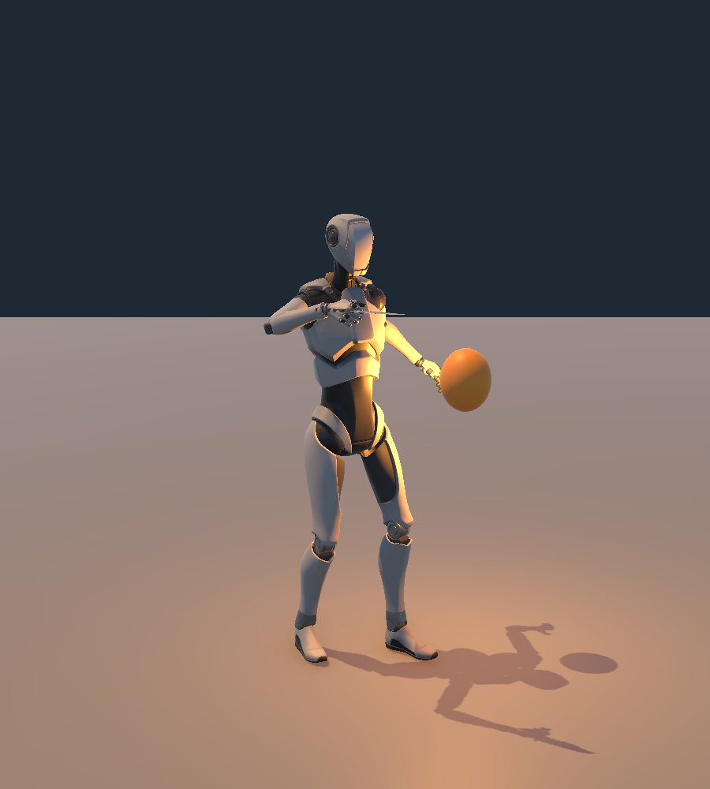

# Tầm Focus và tách chuột trái/phải — 04/11/2026

Người dùng phản hồi Focus vào quái cần đứng quá gần và chuột trái có tia chiếu không hợp lý. Kiểm tra input asset: LMB chỉ Attack, RMB chỉ Focus. Vệt cam theo dao ở bản melee trước dễ bị nhìn thành tia; đã tắt hẳn renderer/emission và xóa điểm vệt còn lại.

## Hành vi mới

- **RMB vào quái: 10 m** thay 8 m. Chọn tăng nhẹ 25% theo yêu cầu “xa hơn tí”; không ghi đây là con số người dùng tự chốt.
- **Puzzle/phong ấn vẫn 8 m**, reveal thường 5 m. IEnemyLanternTarget là marker dùng chung cho EnemyLanternReceiver/ChimLacFocusReceiver, giữ scanner không phụ thuộc vào code chương. Nón 90°/±45°, LOS, chiếu 1 s, năng lượng và thời hạn yếu không đổi.
- FocusLight có visual falloff 12 m, góc 90° và lõi 50°, mặc định tắt. Đây là phạm vi ánh sáng hình ảnh, không tăng combat Focus quá 10 m.
- **LMB chỉ chém dao, không tia/ribbon**. Nếu đang giữ RMB rồi bấm LMB, Focus bị ngắt và không tự bật lại khi vẫn giữ RMB. Thả rồi giữ lại RMB để chiếu tiếp; HUD nhắc thao tác này. Nhấn LMB được ưu tiên kể cả khi không đủ stamina để mở đòn.
- Giữ model dao/clip chém/lunge/hướng camera của bản sửa trước. Trail/material cũ giữ tham chiếu để bảo toàn asset nhưng renderer disabled, không emitting, không còn điểm vệt.

## Kiểm tra

[Play Mode JSON](FocusCombat_PlayMode_2026-11-04.json): **116 checks, 0 failures, 0 errors**, virtual keyboard/mouse qua Input System thật. Các case vệt dao của bản trước được đổi thành khẳng định không có vệt; thêm 10 kiểm tra:

1. EnemyLanternReceiver thật ở 9.3 m từ actor nhận yếu sau giữ RMB.
2. Target puzzle cùng khoảng cách không nhận Focus ngoài 8 m.
3. Light đúng 12 m/góc 90°.
4. LMB ngắt Focus đang giữ, đèn Focus tắt và không có ribbon.
5. Giữ RMB sau đòn không tự phát lại Focus.
6. LMB không gây damage từ xa lên quái.
7. Nhả/nhấn RMB mới bật Focus lại.
8. Quái có AimPoint ngoài 10 m tính từ nguồn đèn không nhận yếu.
9. Vách Environment chặn Focus ở tầm mới.
10. LMB đơn trong cửa sổ damage vẫn chỉ là dao vật lý, không đèn/ribbon.

Giữ các kiểm tra hướng/camera/animation/va chạm/nhảy/lộn/craft/save/Continue/death. Save primary/.bak/.tmp gốc được trả byte-for-byte. Không thay damage, stamina, save schema, ID, collider, EnemyDefinition hoặc AI truy đuổi.

File chính: LanternController, LanternFocusScanner, PlayerMeleeVisual, ILanternTarget, hai receiver quái; prefab An và Editor setup/probe. Backup: `SourceAssets/FocusRangeBackups/2026-11-04/manifest.json`. Bản trước và các report 106/91/76 giữ riêng để truy vết.

Windows mới: `Builds/FocusCombatValidation/Windows/SonDoong.exe`. Kết quả build được ghi riêng trong [Build JSON](FocusCombat_Build_2026-11-04.json). Chưa có chơi tay Windows/đo hiệu năng trong lượt này; cảm giác tầm chiếu vẫn cần người dùng duyệt.
