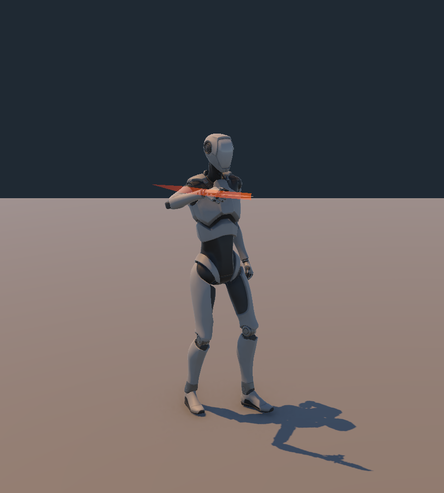

# Sửa động tác dao sau xác nhận người dùng — 04/11/2026

Người dùng xác nhận lỗi gồm **cả hướng đánh và động tác**. Lượt CharacterAim trước đã sửa hướng/chuột; lượt này bổ sung animation và dao thật trên rig hiện có. Không tạo model An/quái mới.

## Kết quả

- **AN_Slash1 / AN_Slash2:** hai đường chém đối hướng, có lấy đà khoảng .11 s, vung qua mục tiêu khoảng .21 s, theo đà .31 s và thu về .65 s. Baked 60 Hz từ pose tay/spine/chest trên Avatar Humanoid hiện có. Giữ body/foot-goal channels từ Idle A01 để chân ổn định.
- **AN_Lunge:** đòn đâm riêng sau lộn, phát từ AttackStarted(lunge=true); không còn dùng lại nhát chém thứ hai.
- **Layer Melee:** CrossFade .035 s; fade ra khi kết thúc/hủy đòn, nằm dưới FullBody roll/death và layer tay đèn. Apply Root Motion vẫn tắt, CombatController tiếp tục quyết định sát thương và PlayerMotor tiếp tục sở hữu di chuyển.
- **KnifeGrip:** model Knife.fbx đã nhập từ A16 Survival Pack, chuẩn hóa dài .34 m, gắn dưới RightHand với điểm nắm cách cổ tay .045 m. Mask/clip riêng giữ ngón phải nắm cán. Không sửa FBX/material nguồn nhập vào; không thêm collider vũ khí.
- **BladeTrail:** vệt nhỏ bám mũi dao, chỉ emitting trong cửa sổ sát thương .15–.30 s; clear khi bắt đầu đòn/teleport/disable. Dừng dùng SlashFX cube cũ trước người.
- **Công cụ:** MeleeVisualSetup bake/capture/validate và menu Rebuild Melee Visuals. AnAnimationBuilder tái dựng controller hiện có tại chỗ; giữ GUID thay vì xóa/copy lại controller mỗi lần.

Giữ nguyên hướng đánh theo camera/lock-on của lượt trước, damage/stamina, thời gian .65 s, điều kiện movement_kit, schema/ID/save và collider môi trường.

## Bằng chứng

[Play Mode](MeleeVisual_PlayMode_2026-11-04.json): **106 checks, 0 failures, 0 errors** bằng virtual keyboard/mouse qua Input System thật, không phải chơi tay. Bao gồm các ca chuột/hướng/collision/jump/dodge/focus/E/craft/save/Continue của lượt trước, cộng:

- Dao thực sự nằm dưới xương bàn tay phải, clip/mask nắm cán đã cấu hình.
- Slash1 rồi Slash2 đúng state; cổ tay đi theo đường chém; chân không nhảy lên; dao giữ trong lòng bàn tay.
- Vệt dao bật lúc có sát thương, tắt khi recovery; lunge phát đúng clip đâm riêng.
- Primary/.bak/.tmp gốc được khôi phục byte-for-byte. Lượt thử đầu dừng vì mất focus; sau khi người dùng đưa Unity lên phía trước, Game View đã nhận focus và bộ thử đầy đủ chạy thành công. Không sửa production focus guards để vượt qua bài thử.

[Editor pose validation](MeleeVisual_Editor_2026-11-04.json): **23 checks**, không failure. Sáu thời điểm trên mỗi clip; chênh độ cao xương chân so với Idle khoảng −8.7..+9.6 mm, khoảng cách grip/cổ tay ≈45 mm, cổ tay di chuyển khoảng .55–.68 m. Các kiểm tra này là số đo bone, không thay cho đánh giá mỹ thuật.

Trong khi biên soạn, thử chuyển toàn bộ HumanPose sang clip gây sai body/foot pose khoảng .20 m. Đã thay bằng giữ channels Idle gốc và chỉ bake tay/thân trên; các ảnh và report cuối dùng phương án đã sửa. Ảnh preview dùng BakeMesh để tránh skinning chậm một nhịp trong Editor.

## Ảnh kiểm tra

Play Mode tại thời điểm có sát thương:

[Slash2](../images/melee-play-Slash2-2026-11-04.png) · [Lunge](../images/melee-play-Lunge-2026-11-04.png)

Các dải ảnh pose lần lượt 0/.11/.21/.31/.60 s:

[Slash1](../images/melee-AN_Slash1-2026-11-04.png) · [Slash2](../images/melee-AN_Slash2-2026-11-04.png) · [Lunge](../images/melee-AN_Lunge-2026-11-04.png)

## Build và bảo toàn

[Windows x64 Release](MeleeVisual_Build_2026-11-04.json): **Succeeded, 0 errors, 485 shader warnings Unity AI Inference/Sentis**. Mở `Builds/MeleeVisualValidation/Windows/SonDoong.exe`; hai bản build trước giữ riêng. Assembly đóng gói có PlayerMeleeVisual/ReadAttackDirection và không chứa probe Editor.

Backup ban đầu kèm SHA256: `SourceAssets/MeleeVisualBackups/2026-11-04/manifest.json`. Đối chiếu GUID prefab/controller/Slash1/Slash2 không đổi. Thay đổi chính: PlayerAnimator, PlayerMeleeVisual, prefab An, controller, 2 clip sửa + Lunge/KnifeGrip/mask/trail mới, Editor builder và probe. Không reset workspace hoặc tạo commit.

Model vẫn là mannequin A01; clip mới là animation bake trong dự án, chưa phải mocap hay phê duyệt model An cuối. Cần người dùng duyệt cảm giác/tư thế trong bản Windows có đồ họa và chiến đấu thực tế; không suy từ 106 checks rằng toàn bộ game/animation đã hoàn thiện.
